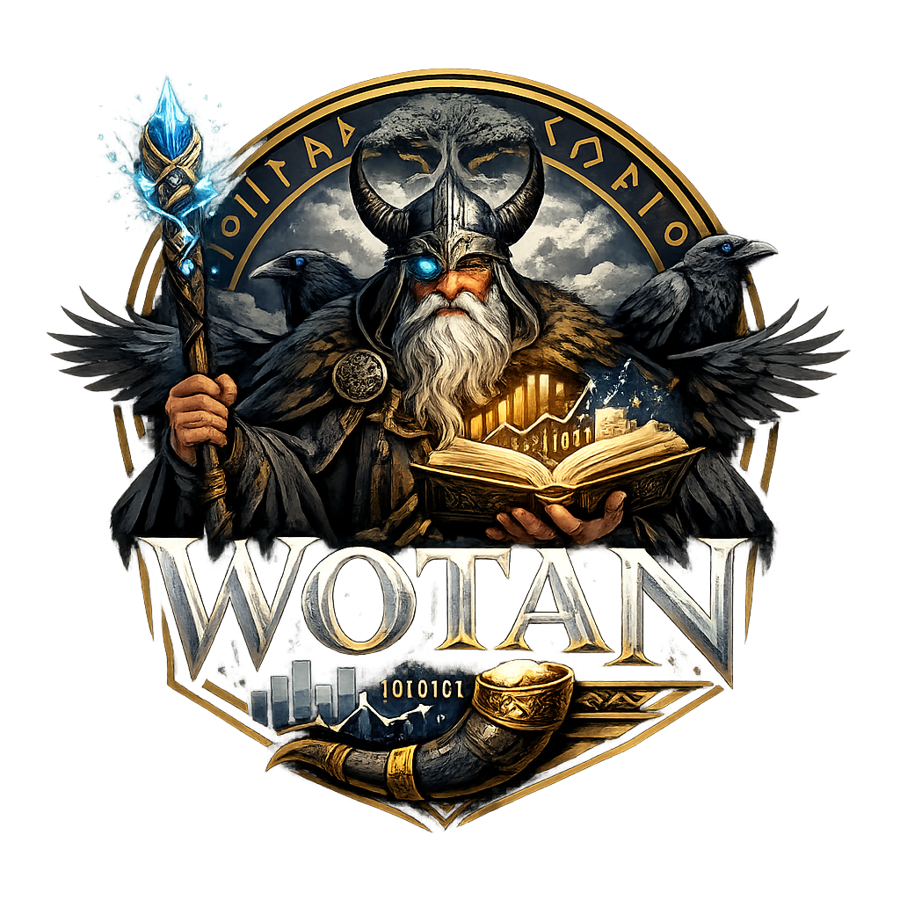

<p align="center">
  
</p>

<h1 align="center">Wotan</h1>

<p align="center">
  DataFrames, statistics, machine learning and quantitative finance, written in <a href="https://odin-lang.org/">Odin</a>.
</p>

<p align="center">
  <a href="LICENSE"></a>
  
  
</p>

---

Wotan is a library for data analysis and quantitative finance in Odin. It started as a typed DataFrame and grew into a toolkit covering time series, classical ML, a small autograd and deep learning stack, and a large set of finance models. It has no Python runtime dependency. The only external library is libcurl, used for HTTP requests.

> **Status:** Wotan covers a lot of ground, but it is still a work in progress. APIs can change between commits and documentation is thin in places. Most modules are checked against reference implementations (QuantLib, statsmodels, SciPy, scikit-learn, PyTorch, Hugging Face) in the test suite. Bug reports and feedback are very welcome.
>
> **Compiler:** Wotan needs Odin **dev-2026-11 or newer**. Older compilers fail to build it. See [Requirements](#requirements).

## Contents

- [Features](#features)
- [Getting started](#getting-started)
- [Examples](#examples)
- [Project layout](#project-layout)
- [Tests](#tests)
- [Optional: pretrained weights](#optional-pretrained-weights)
- [Limitations](#limitations)
- [Contributing](#contributing)
- [License](#license)

## Features

**Data handling** (`core`, `importer`, `exporter`)
- Typed columns: `Int`, `Float`, `String`, `Bool`, `Date`, `Time`, `Datetime`
- Slicing, column selection, sorting, boolean masks and filtering
- Expression-based `select` (arithmetic, type conversion, custom procs)
- GroupBy with aggregations; inner, left, right and outer joins on one or more keys
- Read and write CSV, JSON, JSONL, HTML tables and Excel (`.xlsx`)
- Date, time and datetime arithmetic

**Statistics and time series** (`analytics`, `linalg`)
- Linear algebra: LU, QR, Cholesky, SVD and symmetric eigen decompositions, eigenvalues of general matrices, with SIMD kernels
- Rolling and exponentially weighted statistics, rolling covariance and PCA
- ARMA, ARIMA, SARIMA and ARIMAX (regression with ARIMA errors)
- GARCH with any variance equation (GARCH, GJR, EGARCH) and error distribution (normal, Student-t, GED); regime-switching GARCH
- VAR with impulse responses, Granger causality, Engle–Granger and Johansen cointegration
- HP filter, classical and STL decomposition, Holt–Winters
- Diagnostics: ACF/PACF, Ljung–Box, Jarque–Bera, ADF, KPSS, Phillips–Perron; Durbin–Watson, ARCH-LM, Breusch–Pagan, White, Breusch–Godfrey
- Kalman filter and RTS smoother, EKF, UKF

**Machine learning** (`analytics/ML`)
- OLS (with HC0–HC3, Newey–West and clustered standard errors), WLS, GLS, Ridge, Lasso, ElasticNet
- Logistic regression, naive Bayes, KNN (with `predict_proba`), k-means
- Decision trees, random forests, gradient boosting (with early stopping)
- SVM, kernel SVM, SVR
- Sample weights and balanced class weights
- Standard, min-max and robust scalers; pipelines, grid and random search
- K-fold, stratified and time-series cross-validation
- Metrics, including ROC AUC, average precision, log loss and Brier score; model serialization

**Deep learning** (`tensor`, `nn`, `optimize`)
- Reverse-mode autograd on tensors, with per-graph memory arenas and no-grad (inference) scopes
- Dense, Conv1D/Conv2D, pooling, dropout, batch norm, layer norm, RMSNorm, RNN/GRU/LSTM, TCN
- Transformers (encoder/decoder, multi-head and flash attention), GPT (KV cache, weight tying) and BERT style models, mixture-of-experts, Mamba
- GAN, WGAN, VAE
- Tokenizers: GPT-2 BPE (including training a vocabulary), WordPiece (cased and uncased, sentence pairs), batch encoding; time-series tokenization
- SGD, Adam, AdamW, RMSProp, L-BFGS and learning-rate schedulers

**Quantitative finance** (`finance`, `ml_finance`, `behavioral_finance`)
- European, American (trees, finite differences, LSM) and exotic options; Greeks computed with autograd; implied volatility and volatility surfaces (SABR, Heston)
- Heston, Merton and Bates pricing with the COS method; local volatility; Sobol' sequences and Brownian bridge
- Calendars, business-day conventions, day counts and schedules
- Bonds, callable, puttable and convertible bonds, yield curves, swaps, interest-rate (Hull–White, G2++), FX and credit derivatives, ISDA-style CDS
- Inflation: zero-inflation curves, zero-coupon inflation swaps, inflation-linked bonds
- Variance swaps and quanto options
- Portfolio optimisation with constraints, Black–Litterman, HRP, risk decomposition, VaR/ES, extreme value theory (GPD), factor models, backtesting
- Monte Carlo simulation, copulas, fractional Brownian motion and rough volatility
- ML methods for finance: deep hedging, deep BSDE, DeepLOB, TimeGAN, PPO and CQL agents, Kalman pairs trading, HMM regimes, neural SDF, event studies, probabilistic and token-based forecasting
- Behavioural finance: prospect theory, anchoring, behavioural portfolio theory

**Data sources and output** (`net`, `plot`)
- Yahoo Finance prices, dividends, splits and option chains; one ticker as arrays or several matched by date ([data in and out guide](docs/data_io_guide.md))
- PNG charts: line, multi-line, scatter, histogram, bar and heatmap

## Getting started

### Requirements

- The [Odin](https://odin-lang.org/docs/install/) compiler, version **dev-2026-11 or newer**. Check yours with `odin version`.
  - Older compilers cannot build Wotan. The Excel reader and the PNG tests use `core:compress/deflate`, and that package only exists from dev-2026-11 onwards.
  - With dev-2026-11, `odin check .` reports no errors or warnings.
- libcurl, used through Odin's `vendor:curl` package. It is only needed for the `net` package (Yahoo Finance and HTTP).

### Build and run

```sh
git clone https://github.com/benes83-fra/wotan
cd wotan

odin run . -debug          # runs main.odin; debug builds report memory leaks
```

`main.odin` is the demo and test driver. Comment calls in or out there to choose which examples run.

To build Wotan as a library:

```sh
odin build . -o:speed -build-mode:static
odin build . -o:speed -build-mode:dynamic
```

`makeall.sh` and `makeall.bat` build all three variants.

### Using Wotan in your project

Wotan is a set of ordinary Odin packages. Copy or submodule the `wotan/` directory and import the packages you need:

```odin
import w     "wotan/core"
import io    "wotan/importer"
import ts    "wotan/analytics"
import fin   "wotan/finance"
import net   "wotan/net"
```

## Examples

The examples below are shortened. Every one of them has a complete, runnable version in [`tests/`](tests/). For a step-by-step introduction to DataFrames, see the [core user guide](docs/core_guide.md); the [documentation overview](docs/main_doc.md) lists all the guides.

### DataFrames: load, filter, group, join

```odin
df := io.csv_load("people_dates.csv")            // column types are inferred
defer w.destroy_dataframe(&df)

// Filter: age < 31 AND active
m1   := w.mask_lt(w.column(&df, "age"), 31)
m2   := w.column_mask(w.column(&df, "active"))
mask := w.and(m1, m2)
young_active := w.wobei(&df, mask)
w.dataframe_pretty_print(&young_active, 10)

// Group by age and aggregate salary
gdf := w.groupby(&df, []string{"age"})
out := w.agg(&gdf, []w.Agg_Expr{
    w.count("n"),
    w.sum_agg("total_salary", w.column(&df, "salary")),
    w.avg_agg("avg_salary",   w.column(&df, "salary")),
})
w.dataframe_pretty_print(&out, 10)
```

Joins work on one or more keys:

```odin
people := w.df_from(
    w.column_from_ints("id",      []int{1, 2, 3}),
    w.column_from_strings("name", []string{"Alice", "Bob", "Charlie"}),
)
salary := w.df_from(
    w.column_from_ints("id",       []int{1, 2, 4}),
    w.column_from_floats("salary", []f64{50000, 42000, 90000}),
)

joined := w.join(&people, &salary, []string{"id"}, .Outer)
w.dataframe_pretty_print(&joined, 10)
```

### Option pricing with Greeks from autograd

Greeks are computed by differentiating the pricing graph, not by finite differences.

```odin
S, K, T, r, sigma := 100.0, 100.0, 1.0, 0.05, 0.20

price, g := fin.price_and_greeks(S, K, T, r, sigma, .Call)
fmt.printf("price=%.4f  delta=%.4f  gamma=%.4f  vega=%.4f\n",
    price, g.delta, g.gamma, g.vega)
// price=10.4506  delta=0.6368  gamma=0.0188  vega=0.3752

iv, converged, iters := fin.implied_volatility(10.45, S, K, T, r, .Call)
fmt.printf("implied vol=%.4f (converged=%v after %d iterations)\n", iv, converged, iters)
```

See `tests/american_options_test.odin`, `tests/exotic_pricing_test.odin` and `tests/vol_surface_test.odin` for more.

### Market data and volatility forecasting

```odin
s, ok := net.read_yahoo_series("AAPL", .Daily, .FiveYears) // ok = false: Yahoo unreachable or rate-limiting
if !ok {return}
defer net.yahoo_series_free(&s)

returns := ts.log_returns(s.adj_close) // daily log returns of the adjusted closes
defer delete(returns)

fit := ts.garch_fit(returns, .GARCH, p = 1, q = 1)
fmt.printf("omega=%.6f alpha=%.4f beta=%.4f\n",
    fit.params.omega, fit.params.alpha[0], fit.params.beta[0])

fc := ts.garch_forecast(&fit, returns, horizon = 5)
fmt.printf("5-day vol forecast: %.4f\n", fc.std_forecast)
```

ARIMA works the same way and returns prediction intervals:

```odin
fit := ts.arima_fit(y, 1, 0, 1)
fc  := ts.arima_forecast(y, fit, 1, 0, 1, h = 20, alpha = 0.05)
// fc.mean, fc.lower, fc.upper
```

### Kalman filter pairs trading

```odin
import ml_fin "wotan/ml_finance"

// aligned_df holds two date-aligned price columns
config := ml_fin.kalman_pairs_default_config()
config.entry_threshold = 2.0
config.exit_threshold  = 0.5

result := ml_fin.kalman_pairs_strategy(&aligned_df, "Asset_A", "Asset_B", config)
// result.betas    – dynamic hedge ratio
// result.z_scores – spread z-score
// result.returns  – strategy returns
```

The full version, including date alignment and a parameter grid search, is in `tests/kalman_pairs_test.odin`.

### Autograd

```odin
import l "wotan/linalg"
import t "wotan/tensor"

a := t.tensor_new(l.matrix_new(f64, 2, 2), true)   // requires_grad = true
b := t.tensor_new(l.matrix_new(f64, 2, 2), true)
// ...fill a.data.data and b.data.data...

loss := t.tensor_sum(t.tensor_relu(t.tensor_matmul(a, b)))
t.tensor_backward(loss)
// a.grad and b.grad now hold d(loss)/da and d(loss)/db
```

The same engine runs the neural network layers in `nn`, the deep hedging and deep BSDE solvers, and the Greeks calculation shown above.

### Plotting

```odin
import plot "wotan/plot"

plot.line_png(xs, ys, "equity_curve.png")
```

## Project layout

```
wotan/
├── core/               DataFrame, columns, masks, select, groupby, join, dates
├── importer/           CSV, JSON, JSONL, HTML, Excel readers (with type inference)
├── exporter/           CSV, JSON, HTML, Excel writers
├── linalg/             matrices and decompositions (LU, QR, SVD, eigen, Cholesky)
├── analytics/          time series, statistical tests, Kalman filters, GARCH
│   └── ML/             classical machine learning
├── tensor/             autograd engine
├── nn/                 neural network layers and models, tokenizers
├── optimize/           optimizers and learning-rate schedulers
├── finance/            pricing, fixed income, portfolio, risk, backtesting
├── ml_finance/         ML methods for finance
├── behavioral_finance/ prospect theory, anchoring, behavioural portfolios
├── net/                HTTP via libcurl, Yahoo Finance
├── plot/               PNG chart rendering
├── data/               dataset loaders (MNIST)
├── util/               shared worker pool for parallel loops
└── zip_min/            minimal ZIP reader (used by the Excel importer)
tests/                  runnable examples and regression tests
scripts/                scripts to download MNIST and convert Hugging Face models (FinBERT, DistilGPT-2)
data/                   MNIST and stored SPY prices and options
demo_files/             input files for the I/O tests and demo; export tests write here too
docs/                   Markdown documentation
plots/                  charts written by the demo (created on first run)
model_checkpoints/      converted Hugging Face weights and vocabularies, and checkpoints written by the tests (created on first run)
main.odin               demo and test driver
```

## Tests

`tests/` holds about 200 files with close to 400 test procedures. They cover DataFrame operations, I/O, linear algebra, every ML model, the deep learning stack, and the finance modules. Each is a plain `proc(allocator: mem.Allocator)` called from `main.odin`. [`test_catalog.md`](docs/test_catalog.md) lists what each file covers.

There are three kinds of test:

- **Reference tests** (`*_reference_test`) compare results with values from established libraries: QuantLib 1.44, statsmodels 0.13.5, SciPy 1.10, scikit-learn 1.2.1, hmmlearn 0.3.3, pykalman 0.11.2, TA-Lib 0.8.3, NumPy/pandas, PyTorch (float64), and Hugging Face `transformers` / `tokenizers`. The reference values are hard-coded in the test files.
- **Contract tests** (`*_contracts_test`, the `gradcheck_*` tests and others) check properties instead of fixed numbers. Examples: gradients against finite differences, bit-identical results across thread counts, save/load round trips, and memory that is fully released.
- **Examples and demos** print results, often next to textbook values, and some write PNG charts to `plots/`. Tests marked 🌐 in the catalog need network access (Yahoo Finance and other HTTP sources).

Reference and contract tests print `OK` or `FAIL` for each check. Failed checks are counted, and the program exits with code 1 if any failed. Almost every test seeds the random generator from its own name, so runs are reproducible and do not depend on which other tests ran before.

Run with `-debug` to turn on the tracking allocator. It reports any leaked allocation when the program exits.

## Optional: pretrained weights

The FinBERT and GPT-2 examples can load Hugging Face weights. The conversion scripts need Python with `transformers` installed. Run them from `scripts/`, because they write to `../model_checkpoints/`:

```sh
cd scripts
python convert_bert.py ProsusAI/finbert finbert_checkpoint.bin
python convert_gpt2.py
```

Without the FinBERT checkpoint, the event-study example runs with randomly initialised weights. Without the DistilGPT-2 checkpoint, `gpt_completion_test` prints a notice and skips.

The GPT-2 and BERT vocabularies (`vocab.json`, `merges.txt`, `bert_vocab.txt`) are downloaded into `model_checkpoints/` the first time `gpt_completion_test` and `event_study_test` run. `tokenizer_reference_test` skips its checks on the real vocabularies until they are there.

## Limitations

These are areas where Wotan is known to be incomplete:

- **API stability:** names and signatures are still changing. There are no versioned releases yet.
- **Documentation:** every package has a user guide, except a few small support packages. [`docs/main_doc.md`](docs/main_doc.md) is the entry point: it gives an overview of the packages, links each guide and lists the conventions they share.
- **Performance:** everything runs on the CPU. Some hot paths use SIMD, but most code has not been profiled or tuned, and large deep learning models are slow.
- **Validation:** most modules are tested against reference libraries (see [Tests](#tests)). The ML-for-finance models are mostly checked by examples rather than references; the behavioural finance models reproduce their papers' published tables and examples. Nothing has been validated for production trading or risk use.
- **Memory management:** ownership is explicit, as is usual in Odin. Most objects need a matching `destroy_*` or `*_free` call.

## Contributing

Contributions, bug reports and feature requests are welcome. Please open an issue or a pull request. When you add a feature, please also add a test in `tests/` that shows how to use it.

## License

[MIT](LICENSE) © 2026 Benjamin Eßer
