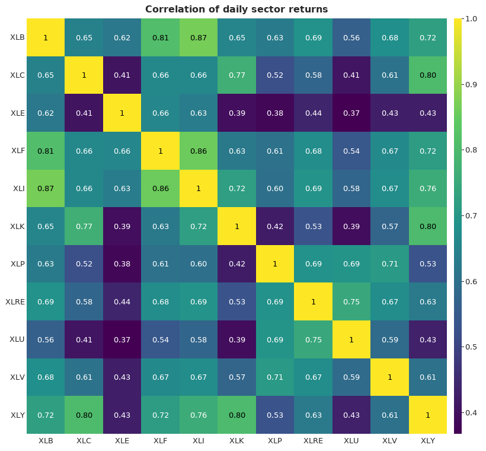
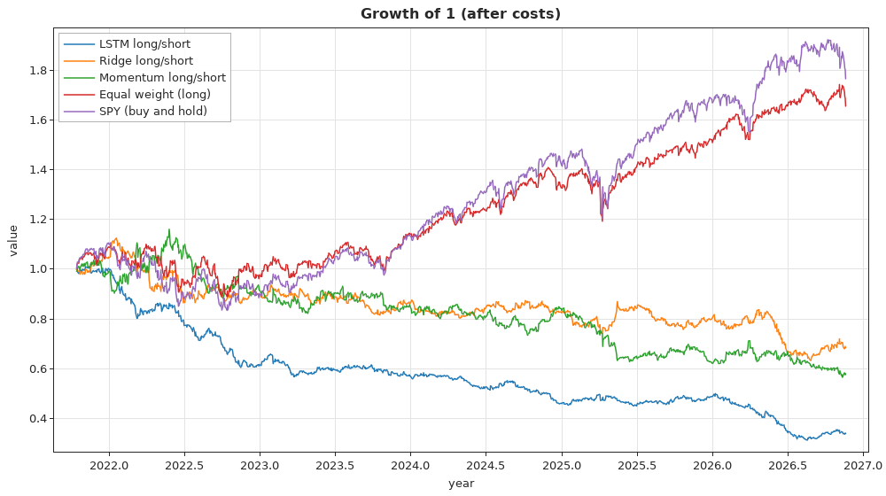
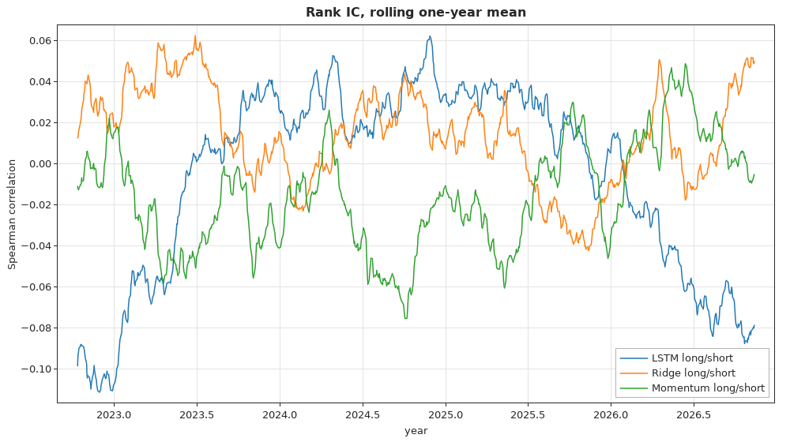
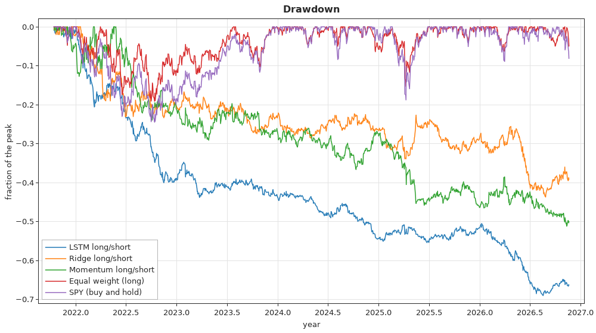

# End-to-end example: a sector-rotation strategy

This example builds a complete quantitative strategy from start to finish with Wotan, on real market data:

1. **Data:** ten years of daily prices and volumes of the eleven US sector ETFs, from Yahoo Finance.
2. **Features:** eight signals per sector and day, compared across sectors.
3. **Models:** an LSTM trained on the GPU, a ridge regression and a momentum rule, each forecasting which sectors will do best over the next week.
4. **Walk-forward testing:** the models are refitted every six months and only ever forecast data they have not seen.
5. **Portfolio:** every week, buy the three sectors with the best forecast and sell the three with the worst, paying realistic trading costs.
6. **Evaluation and report:** returns, risk, statistical significance, charts, an Excel workbook and an HTML table.

The program is in [`examples/sector_rotation`](../examples/sector_rotation), one file per stage. Each section below shows the important code and the real output of a run on 2026-11-19.

The answer the example gives is honest, and typical: **none of the three forecasters finds a usable edge.** Their forecasts are no better than chance, and trading on them loses money, mostly through costs. A large part of the example is about how the evaluation tools tell you so before you trade. Section 7 discusses the results.

## Contents

1. [Running the example](#1-running-the-example)
2. [Market data](#2-market-data)
3. [Features and targets](#3-features-and-targets)
4. [The models](#4-the-models)
5. [Walk-forward forecasts](#5-walk-forward-forecasts)
6. [Portfolios and trading costs](#6-portfolios-and-trading-costs)
7. [Results](#7-results)
8. [Things to try](#8-things-to-try)
9. [The packages used](#9-the-packages-used)

## 1. Running the example

From the repository root:

```sh
odin run examples/sector_rotation -o:speed            # LSTM on the GPU if there is one
odin run examples/sector_rotation -o:speed -- -cpu    # LSTM on the CPU
```

- **Network:** the program downloads its data from Yahoo Finance. Without a connection it stops after step 1 with a message, and does not invent data.
- **GPU:** the LSTM trains on the GPU when one is available (see the [gpu guide](gpu_guide.md#1-setup)), and on the CPU otherwise. On the test machine the whole run takes 30 s with an RTX 3060 Laptop GPU and about 2 minutes on the CPU (Ryzen 7 6800H).
- **Output:** the charts, an Excel workbook and an HTML table go to `examples/sector_rotation/output/`.

The results change a little from day to day, because Yahoo's data grows by one day. LSTM results also vary a little between runs on the GPU, and between the GPU and the CPU: the GPU computes in `f32`, the CPU in `f64`, and small differences grow during training. The ridge and momentum results are the same on every run of the same data.

`main.odin` puts all the run's data in one arena (`core:mem/virtual`), freed at the end. That keeps the memory handling out of the way of the finance.

## 2. Market data

`net.read_yahoo_panel` downloads several tickers and keeps the days on which all of them traded ([data I/O guide, section 10.3](data_io_guide.md#103-several-tickers-read_yahoo_panel)):

```odin
SECTORS := [?]string{"XLB", "XLC", "XLE", "XLF", "XLI", "XLK", "XLP", "XLRE", "XLU", "XLV", "XLY"}

panel, loaded, failed := net.read_yahoo_panel(tickers[:], .Daily, .TenYears) // the sectors and SPY
if !loaded {
	fmt.printfln("could not load %s from Yahoo Finance (no network?)", tickers[failed])
	return
}
```

```
1. Market data
  11 sector ETFs and SPY, 2118 common trading days: 2018-06-19 .. 2026-11-19
```

Ten years were requested, but the communication-services fund XLC started in June 2018, so the common history begins there.

**Today's row.** While the US market is open, Yahoo's last row holds the current prices, not closing prices. The panel then has `last_is_live` set ([data I/O guide, section 10.4](data_io_guide.md#104-todays-row-while-the-market-is-open)), and `load_market` leaves that row out, so the backtest never trades on a price that may still change.

The sectors move together, but not equally. Energy (XLE) and utilities (XLU) are the most independent:



## 3. Features and targets

For each sector and day, `build_dataset` computes eight features from data up to and including that day:

| Feature | Source |
|---|---|
| log return, RSI(14), volume z-score, volume ratio | `mlf.compute_trading_features` ([ml_finance methods, section 7](ml_finance_methods_guide.md#trading-features)) |
| momentum over 20 and 60 days | log price change |
| volatility over 20 days | standard deviation of daily log returns |
| fractionally differenced log price | `mlf.frac_diff_ffd` ([methods, section 4](ml_finance_methods_guide.md#4-fractional-differencing)) |

**Fractional differencing** makes a price series stationary while keeping as much of its memory as possible. `mlf.frac_diff_min_d` finds the smallest order d that passes the ADF test. The example looks for d on the first three years only, the period before the first forecast, so later data does not influence it:

```odin
r := mlf.frac_diff_min_d(log_price[a][:fit_days], threshold = 1e-3)
ds.frac_d = max(ds.frac_d, r.d) // one d for all sectors
```

**Cross-sectional z-scores.** The strategy bets on sectors against each other, not on the market. So each day every feature is z-scored across the eleven sectors: a value of 1 means one standard deviation above the other sectors that day.

**The target** is a sector's log return over the next five trading days minus the average of all sectors, in percent: does this sector beat the others next week?

```
2. Features
  8 features per sector and day, from 2018-09-13 on (day 60); fractional differencing d = 0.35
```

The 60-day momentum needs 60 days of history, so the features start on day 60.

## 4. The models

All three models produce one number per sector and day; only the ranking of the sectors matters.

**The LSTM** reads the last 20 days of a sector's features. It is an `nn.Sequential`, the same model for all sectors ([nn guide](nn_guide.md)):

```odin
m := nn.sequential_new()
nn.sequential_add(m, nn.lstm_layer_new(N_FEATURES, LSTM_HIDDEN))     // [B, 20, 32]
nn.sequential_add(m, nn.FlattenLayer{})                              // [B, 640]
nn.sequential_add(m, nn.linear_layer_new(WINDOW * LSTM_HIDDEN, LSTM_HIDDEN))
nn.sequential_add(m, nn.Activation.ReLU)
nn.sequential_add(m, nn.linear_layer_new(LSTM_HIDDEN, 1))
```

It trains for 12 epochs with Adam on the mean squared error, in shuffled batches of 256. On the GPU, the training loop is the CPU loop plus one line that moves the parameters ([gpu guide](gpu_guide.md)):

```odin
params := nn.sequential_parameters(model)
if on_gpu {gpu.to_device(params[:])}
...
// one input tensor, refilled for every batch
xs, ys := t.tensor_values(x), t.tensor_values(y)
for s, i in order[b:][:BATCH] {
	window_into(ds, samples[s].day, samples[s].asset, xs[i * WINDOW * N_FEATURES:][:WINDOW * N_FEATURES])
	ys[i] = ds.target[samples[s].day * N_ASSETS + samples[s].asset]
}
t.tensor_mark_host_dirty(x) // the next GPU op uploads the new batch
t.tensor_mark_host_dirty(y)

t.graph_begin(&scope)
batch_loss := t.tensor_mse_loss(nn.sequential_forward(model, x), y)
t.tensor_backward(batch_loss)
if epoch == EPOCHS - 1 {sum += t.tensor_item(batch_loss); n += 1} // a read waits for the GPU
t.graph_end(&scope)
nn.adam_step(&opt)
nn.adam_zero_grad(&opt)
```

Two details keep the GPU busy:
- The input and target tensors are created once and refilled for every batch. `tensor_mark_host_dirty` tells the backend that the host copy changed.
- The loss is read only in the last epoch. Every read waits until the GPU has finished all queued work.

**The ridge regression** fits the target on the features of the last day, with an intercept, using `ml.ridge_fit` ([ML guide](ml_guide.md)). **The momentum rule** fits nothing: its forecast is the 60-day momentum feature. It is the classic sector-rotation signal, and the baseline the learned models have to beat.

## 5. Walk-forward forecasts

A model must never be evaluated on data it was trained on. The example tests walk-forward:
- After three years of history, all models are fitted on everything known so far.
- They forecast the next six months.
- Then they are refitted with those six months added, and so on to the end.

**Purging.** The target of day d covers days d+1 to d+5. So a training sample from the last five days before a test period would contain returns from inside it. The training data therefore ends five days before each test period begins (López de Prado's *purging*):

```odin
// Purging: the target of day d covers days d+1 ..= d+HORIZON, so the
// training days stop HORIZON days before the test period begins
samples := training_samples(ds, first, s - HORIZON - 1)
```

```
3./4. Models and walk-forward forecasts
  LSTM on the GPU: NVIDIA GeForce RTX 3060 Laptop GPU
  fold 1: trained on 2018-10-10 .. 2021-10-04 ( 8261 samples, loss 2.457,  1.3 s), forecasts 2021-10-12 .. 2022-04-11
  fold 2: trained on 2018-10-10 .. 2022-04-04 ( 9647 samples, loss 2.515,  1.5 s), forecasts 2022-04-12 .. 2022-10-11
  ...
  fold 11: trained on 2018-10-10 .. 2026-10-12 (22121 samples, loss 2.606,  3.4 s), forecasts 2026-10-20 .. 2026-11-18
  LSTM training and forecasting: 25.9 s in total
```

The training loss, about 2.5, is well below the variance of the target, 3.8: on its training data the LSTM finds patterns. Section 7 shows that they do not carry over to the six months that follow. That is overfitting, and with financial returns it is the rule rather than the exception.

## 6. Portfolios and trading costs

Every five trading days, at the close, each strategy ranks the sectors by forecast. It buys the top three and sells short the bottom three, a third of the capital each. Between rebalances the positions drift with the prices. Two benchmarks run over the same days: an equal-weight portfolio of all eleven sectors, rebalanced weekly, and SPY bought and held.

**Trading costs** come from `ml_finance`'s cost model ([methods guide, section 9](ml_finance_methods_guide.md#9-transaction-costs)): a half spread of 1 basis point, plus market impact by the square-root law, from each sector's 20-day volatility and dollar volume (`mlf.liquidity_estimates`, known at each day's close). The book is $10 million:

```odin
cost = mlf.rebalance_cost(
	mlf.DEFAULT_COST_MODEL,
	w[:],          // the positions now, after drifting
	target[:],     // the new positions
	CAPITAL * equity,
	liq.sigma[d * N_ASSETS:][:N_ASSETS],
	liq.adv[d * N_ASSETS:][:N_ASSETS],
)
```

## 7. Results

```
5. Portfolios (weekly rebalancing, costs included)
  test period 2021-10-13 .. 2026-11-19 (1282 days), annualised; VaR and ES of one day
                           return     vol  Sharpe (gross)    PSR   max DD  VaR 95   ES 95  turnover    costs  rank IC   ICIR
  LSTM long/short          -19.1%   12.9%   -1.58   -0.88   0.00   -69.0%   1.36%   1.89%      119%    9.03%   -0.021  -0.06
  Ridge long/short          -7.2%   13.9%   -0.47    0.08   0.14   -43.7%   1.50%   2.03%       91%    7.55%    0.012   0.03
  Momentum long/short      -10.2%   17.0%   -0.55   -0.34   0.11   -51.2%   1.74%   2.51%       47%    3.57%   -0.014  -0.04
  Equal weight (long)       10.4%   14.7%    0.75    0.75   0.95   -19.1%   1.38%   2.14%        1%    0.02%        -      -
  SPY (buy and hold)        11.8%   17.2%    0.73    0.73   0.95   -24.5%   1.68%   2.50%         -        -        -      -
  best of the 3 long/short strategies: Ridge long/short, deflated Sharpe ratio 0.01 (P[skill] after picking the best)
  track record the equal-weight portfolio's Sharpe ratio needs to be positive with 95% confidence: 4.9 years
```

The columns:
- **Return, vol:** annualised geometric return and volatility, after costs.
- **Sharpe:** the annualised Sharpe ratio after costs; **(gross)** before costs.
- **PSR:** the probabilistic Sharpe ratio, the probability that the true Sharpe ratio is above 0 ([methods, section 6](ml_finance_methods_guide.md#6-backtest-statistics)).
- **Max DD:** the largest fall from a peak.
- **VaR 95, ES 95:** one-day historical value at risk and expected shortfall ([finance risk guide](finance_risk_guide.md)).
- **Turnover:** the share of the capital traded per rebalance.
- **Costs:** per year, as a fraction of the capital.
- **Rank IC, ICIR:** the mean daily Spearman correlation between forecast and realised target across the sectors, and that mean divided by its standard deviation. `mlf.rank_ic_series` gives the IC of every test day, `mlf.rank_ic_summary` the mean and ICIR, here and over each one-year window of the chart below ([methods, section 7](ml_finance_methods_guide.md#7-signal-evaluation)).



**What the numbers say:**
- **The forecasts carry no information.** A rank IC between −0.02 and 0.01 is noise: a useful cross-sectional signal has an IC of a few hundredths, *consistently*. The rolling IC below swings between −0.1 and +0.06, and the sign changes from year to year.
- **The LSTM fits noise.** Its gross Sharpe ratio of −0.88 means it ranked the sectors slightly the wrong way. It also trades the most (119% per week), because noise changes its ranking every week.
- **Costs decide the rest.** The square-root impact of $10 million in the less traded funds (XLRE trades about $290 million a day, XLB and XLC about $700 million, the large sectors over $2 billion) adds up to 4–9% a year at these turnovers. That is more than any plausible edge in weekly sector bets. The ridge strategy is nearly flat before costs (gross Sharpe 0.08), and down 7% a year after.
- **The deflated Sharpe ratio** asks: after picking the best of three strategies, what is the probability that its Sharpe ratio reflects skill? With 0.01, none.
- **Even the benchmark is hard to prove.** The equal-weight portfolio's Sharpe ratio of 0.75 needs 4.9 years of data before it is positive with 95% confidence (the minimum track record length). The test period is 5.1 years.





None of this is a flaw of the models or the library. Weekly sector returns are close to unpredictable from their own past, and a backtest that showed otherwise would be the one to distrust. The point of the example is the pipeline: real data, features without look-ahead, purged walk-forward testing, realistic costs and statistics that account for luck and selection. Your own ideas can go through the same pipeline.

**The files.** `daily_returns.xlsx` holds the daily net returns of all five strategies, with dates, for Excel or pandas (`ex.xlsx_save`). `summary.html` holds the statistics table (`ex.html_write`). Both are built as DataFrames with `w.df_from` ([core guide](core_guide.md)). The charts use `plot.multi_line_png` and `plot.heatmap_png` ([plot guide](plot_guide.md)).

## 8. Things to try

Each of these is a small change in one file:
- **Other sequence models:** replace the LSTM layer by `nn.sequential_add_seq_block(m, .GRU, ...)`, `.Mamba` or `.TCN` (`models.odin`). All of them run on the GPU.
- **A longer horizon:** set `HORIZON` to 20 for monthly bets. Momentum is a stronger effect over months than over weeks, and costs fall with the turnover.
- **Fewer trades:** keep the current positions unless the new ranking differs by more than one place. That cuts the turnover, and so the costs.
- **A smaller book:** with `CAPITAL` at $1 million the impact costs drop by about two thirds.
- **More features:** add them in `build_dataset` and raise `N_FEATURES`. `mlf.compute_trading_features` and `analytics` (rolling statistics, GARCH volatility) have more.
- **Long only:** hold the top three sectors only, weighted with `mlf.hrp_allocate` instead of equally ([methods guide, section 8](ml_finance_methods_guide.md#8-hierarchical-risk-parity)).

After each change, look at the rank IC and the deflated Sharpe ratio first: every variant you try is one more trial.

## 9. The packages used

| Stage | Package | Procedures |
|---|---|---|
| data | `net`, `core` | `read_yahoo_panel`, `date_to_string` |
| features | `ml_finance` | `compute_trading_features`, `frac_diff_min_d`, `frac_diff_ffd` |
| models | `nn`, `tensor`, `gpu`, `analytics/ML` | `sequential_new`, `lstm_layer_new`, `linear_layer_new`, `adam_*`, `tensor_mse_loss`, `graph_begin` / `graph_end`, `gpu.init`, `gpu.to_device`, `ridge_fit` |
| evaluation | `ml_finance`, `finance` | `rank_ic_series`, `rank_ic_summary`, `liquidity_estimates`, `rebalance_cost`, `sharpe_stats`, `probabilistic_sharpe_ratio_returns`, `deflated_sharpe_trials`, `min_track_record_length`, `max_drawdown`, `drawdown_series`, `value_at_risk`, `expected_shortfall`, `correlation` |
| report | `plot`, `exporter`, `core` | `multi_line_png`, `heatmap_png`, `xlsx_save`, `html_write`, `df_from`, `column_from_*` |
