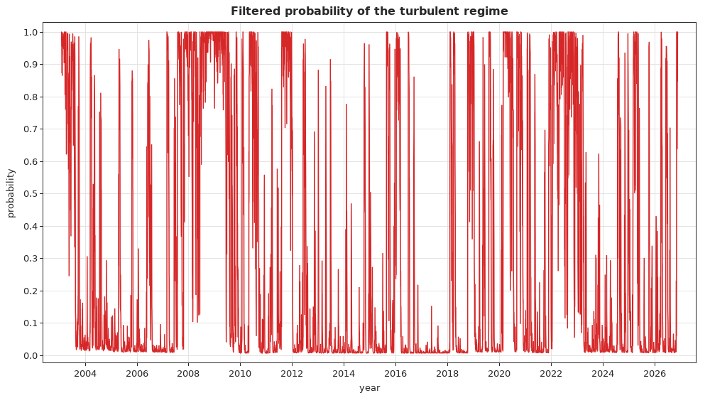
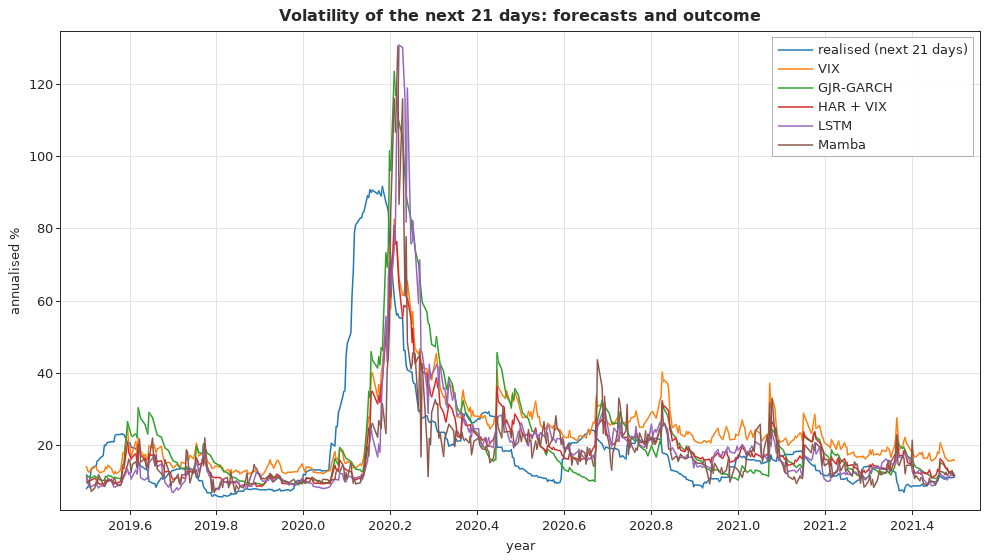
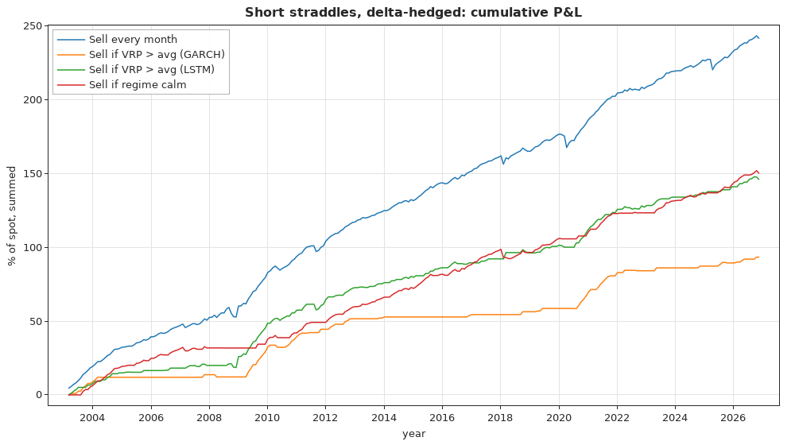
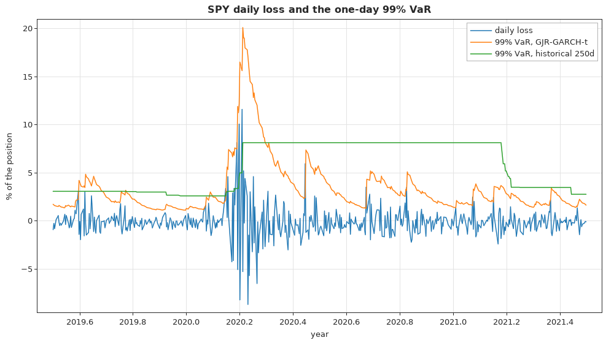

# End-to-end example: forecasting volatility, and trading and managing risk with it

This example forecasts the volatility of the S&P 500 and puts the forecasts to work, from start to finish with Wotan, on real market data:

1. **Data:** SPY's daily prices and the VIX since 1993, from Yahoo Finance.
2. **Forecasters:** five forecasts of the volatility of the next month: the VIX itself, a GJR-GARCH model, a HAR regression, and an LSTM and a Mamba network trained on the GPU.
3. **Regimes:** a hidden Markov model that tells calm markets from turbulent ones, using only the data up to each day.
4. **Walk-forward testing:** every model is refitted every two years and only ever forecasts days it has not seen. The forecasts are scored and compared with formal tests.
5. **Options:** selling one-month straddles every month, and only when a forecast or the regime model says so.
6. **Risk:** the one-day 99% value at risk from three models, backtested over 24 years.
7. **Report:** charts, an Excel workbook and HTML tables.

The program is in [`examples/volatility`](../examples/volatility), one file per stage. Each section below shows the important code and the real output of a run on 2026-11-21, with data up to the close of 2026-11-20.

The results, in short:
- **The simple models win.** A linear regression on past volatility and the VIX has the smallest forecast error. GARCH has the best score on the loss that matters for variance forecasts. The neural networks are significantly worse than GARCH.
- **The VIX is too high on average**, by 3.7 volatility points. Sellers of options earn that difference, and a delta-hedged straddle seller made money in 83% of the months, with a Sharpe ratio above 2. That result rests on pricing the options at the VIX; section 6 shows how fragile it is.
- **Timing the sales does not help.** Selling only when a forecast says options are expensive, or only in calm markets, earns less and does not improve the Sharpe ratio.
- **Value at risk:** GARCH's VaR is breached on 1.3% of the days instead of 1%, and historical simulation's on 1.4%; the standard backtest rejects both. The VIX is too cautious and passes.

## Contents

1. [Running the example](#1-running-the-example)
2. [Market data](#2-market-data)
3. [The forecasters](#3-the-forecasters)
4. [Regimes](#4-regimes)
5. [Walk-forward forecasts and their accuracy](#5-walk-forward-forecasts-and-their-accuracy)
6. [Selling volatility](#6-selling-volatility)
7. [Value at risk](#7-value-at-risk)
8. [Things to try](#8-things-to-try)
9. [Validation](#9-validation)
10. [The packages used](#10-the-packages-used)

## 1. Running the example

From the repository root:

```sh
odin run examples/volatility -o:speed            # LSTM and Mamba on the GPU if there is one
odin run examples/volatility -o:speed -- -cpu    # on the CPU
```

- **Network:** the program downloads its data from Yahoo Finance. Without a connection it stops after step 1 with a message, and does not invent data.
- **GPU:** the networks train on the GPU when one is available (see the [gpu guide](gpu_guide.md#1-setup)), and on the CPU otherwise. On the test machine (Ryzen 7 6800H, RTX 3060 Laptop GPU) the run takes about one minute, and two and a half on the CPU. Nearly all of it is the two networks: 61 s on the GPU and 135 s on the CPU. The 12 GARCH fits take half a second.
- **Output:** the charts, an Excel workbook and two HTML tables go to `examples/volatility/output/`.

The results change a little from day to day, because Yahoo's data grows by one day. The LSTM and Mamba results also vary a little between runs on the GPU, and between the GPU and the CPU: the GPU computes in `f32`, the CPU in `f64`, and small differences grow during training. Everything else is the same on every run of the same data.

## 2. Market data

`net.read_yahoo_panel` loads both series and keeps the days on which both have a value ([data I/O guide, section 10.3](data_io_guide.md#103-several-tickers-read_yahoo_panel)). The range `.Max` gives all of SPY's history, which starts in January 1993:

```odin
tickers := []string{"SPY", "^VIX"}
panel, loaded, failed := net.read_yahoo_panel(tickers, .Daily, .Max)
// ...
if panel.last_is_live {T -= 1} // during the session the last row holds current prices
```

```
1. Market data
  SPY and the VIX, 8512 common trading days: 1993-01-29 .. 2026-11-20
```

Day *d*'s return is ln(S_d / S_{d−1}), from SPY's adjusted close, so dividends are included. The quantity to forecast is the **realised volatility of the next 21 trading days** (one month), annualised as option traders do:

σ_real(d) = 100 · √(252 · mean(r²_{d+1}, …, r²_{d+21}))

There is no demeaning: over a month the mean return is negligible next to the daily moves. The horizon of 21 days is the horizon of the VIX, the market's 30-calendar-day implied volatility of the S&P 500, which makes the VIX a forecast to compare against.

## 3. The forecasters

All forecasts are made at the close of day *d*, with the data up to that close, and are in annualised volatility points (20 = 20%).

### The VIX

The VIX is the market's price of volatility, read from option prices. Used directly as a forecast, it needs no fitting. It is a *risk-neutral* forecast, however: buyers pay a premium for protection, so the VIX is on average above the volatility that follows. Section 5 measures that bias.

### GJR-GARCH with Student-t errors

`ts.garch_fit_spec` fits the model to the returns before the fold, in percent and demeaned ([analytics guide, section 11](analytics_guide.md#11-garch-and-volatility)). The variance of the next day's return reacts to today's return, more strongly to a loss (the leverage term γ):

σ²_{d+1} = ω + (α + γ · 1[r_d < 0]) r_d² + β σ²_d

```odin
fit := ts.garch_fit_spec(x, {variance = .GJR, dist = .StudentT, p = 1, q = 1}, allocator = context.temp_allocator)
// continue the fit's variance recursion through the fold, then:
f.vol[.GARCH][d] = fin.garch_term_structure_vol(om, al + ga / 2, be, v, HORIZON)
f.var99[d] = z99 * math.sqrt(v) / 100 // z99 = ts.garch_std_quantile(&fit.params, 0.99)
```

The forecast for the month averages the expected variance path: `fin.garch_term_structure_vol` steps the variance towards its long-run level with persistence α + β, and losses and gains are equally likely, so the leverage term adds γ/2 ([options guide, section 4](finance_options_guide.md#4-differentiable-blackscholes-and-garch-volatility)). The same fit gives the one-day value at risk of section 7.

The fits, one per fold:

```
  fold  1: 2003-01-30 .. 2005-01-28 | GARCH a 0.000 b 0.923 g 0.141 nu  7.1 | ...
  ...
  fold 12: 2025-02-11 .. 2026-11-20 | GARCH a 0.000 b 0.886 g 0.200 nu  6.7 | ...
```

On the S&P 500, α is 0: a gain does not raise the volatility at all, and all the reaction to news comes through γ, on losses. ν between 6 and 8 says that daily returns have fat tails even after the volatility is accounted for.

### HAR + VIX

Corsi's heterogeneous autoregressive model is a linear regression of the coming month's realised volatility on the realised volatility of the last day, week (5 days) and month (22 days). The VIX is added as a fifth regressor. The fit uses `ml.ols_fit` on all days whose 21-day target had ended before the fold began:

```odin
har_row :: proc(m: ^Market, d: int) -> [5]f64 {
	return {1, realised_vol(m, d, 1), realised_vol(m, d, 5), realised_vol(m, d, 22), m.vix[d]}
}
res := ml.ols_fit(&X, y, allocator = context.temp_allocator)
defer ml.ols_result_free(&res, context.temp_allocator)
```

The VIX carries most of the weight. Its coefficient is 0.86 in the first fold and 0.67 in the last, so the regression is largely a rescaled VIX with a correction from the last week's volatility.

### LSTM and Mamba

The two networks see the last 22 days of five features (the return, its absolute value, the logarithms of the 5- and 22-day realised volatility and of the VIX) and forecast the logarithm of the coming month's volatility. One builder makes both: `nn.sequential_add_seq_block` adds an LSTM, or a linear map followed by a Mamba block, and the rest is the same:

```odin
model := nn.sequential_new()
nn.sequential_add_seq_block(model, backend, N_FEATURES, HIDDEN) // .LSTM or .Mamba
nn.sequential_add(model, nn.FlattenLayer{})
nn.sequential_add(model, nn.linear_layer_new(SEQ * HIDDEN, HIDDEN))
nn.sequential_add(model, nn.Activation.ReLU)
nn.sequential_add(model, nn.linear_layer_new(HIDDEN, 1))
```

- **Scaling:** the features and the target are standardised with the training days' mean and standard deviation. A network whose outputs are of order 1 learns poorly on targets of order 0.01, and the logarithm keeps the forecast positive.
- **Training:** 15 epochs of Adam on the mean squared error, in batches of 128, on the GPU after `gpu.to_device` on the parameters. The batch tensors are refilled in place and marked with `t.tensor_mark_host_dirty`, as in the [sector-rotation example](e2e_sector_rotation_guide.md#4-the-models).
- **Back to volatility:** exp(forecast) is the *median* of a skewed quantity, not its mean. The forecast is multiplied by Duan's smearing factor, the mean of exp(residual) over the training days.

## 4. Regimes

A two-state Gaussian hidden Markov model of the daily returns ([forecasting guide, section 6](ml_finance_forecasting_guide.md#6-regimes-the-hidden-markov-model)) is fitted on the days before each fold. `hmm_filter` then gives, for every day of the fold, the probability of the turbulent state given the returns *up to that day*. Unlike the Viterbi path or smoothed probabilities, this uses no future data, so a strategy can act on it at that day's close:

```odin
mlf.hmm_init_simple(&h, train)
mlf.hmm_fit(&h, train)
turb := 1 if h.emission_var[1] > h.emission_var[0] else 0
filt := mlf.hmm_filter(&h, obs, context.temp_allocator) // obs: the returns up to the fold's end
for d in s ..< e {f.p_turbulent[d] = filt[(d - 1) * 2 + turb]}
```

```
  fold  1: ... | regimes  9.8% / 23.9% | ...
  fold 12: ... | regimes 10.7% / 28.9% | ...
  1774 of them (30%) in the turbulent regime
```

The calm state has an annualised volatility of about 10%, the turbulent state 24–30%. Both are persistent: in the first and the last fold, the model stays in a state with a probability of 0.97 to 0.99 per day. Over the 24 test years, 30% of the days were turbulent.



The turbulent periods are the ones you would expect. More than a third of the days were turbulent in 2003, 2007–2011, 2018, 2020 and 2022, and almost none in 2013–14 and 2017. The filtered probability also flickers on single large moves in otherwise calm times.

## 5. Walk-forward forecasts and their accuracy

The first ten years (1993–2003) are training data only. From 2003-01-30 on, every two years, every model is fitted again on all the days before and forecasts the next two years:

```odin
for s := f.test_lo; s < T; s += RETRAIN_EVERY {
	e := min(s + RETRAIN_EVERY, T)
	g := garch_fold(m, s, e, &f)
	har_fold(m, s, e, &f)
	net_fold(m, .LSTM, s, e, on_gpu, u64(100 + fold), f.vol[.LSTM])
	net_fold(m, .Mamba, s, e, on_gpu, u64(200 + fold), f.vol[.Mamba])
	r := regime_fold(m, s, e, &f)
	// ...
}
```

**Purging.** The target of day *d* covers days *d* + 1 to *d* + 21. The regression and the networks therefore train only on days up to *s* − 22, whose target had ended before the fold began. Without the gap, the last training targets would overlap the first test days.

### Scores

Three measures compare the forecasts with what followed:
- **RMSE and bias**, in volatility points.
- **QLIKE**, σ²_real/σ²_f − ln(σ²_real/σ²_f) − 1 on variances. Realised volatility is only a noisy measurement of the true volatility. QLIKE is one of the few losses that still ranks forecasts correctly with such a noisy target (Patton 2011). It also punishes forecasts that are too low more than forecasts that are too high, as a risk manager would.
- **Diebold–Mariano tests** against GARCH: is a model's mean QLIKE significantly different from GARCH's? The forecasts overlap, since each covers the next 21 days, so the loss differences are autocorrelated. The test is a regression of the difference on a constant, with Newey–West standard errors over 20 lags ([ML guide, robust standard errors](ml_guide.md#robust-standard-errors)):

```odin
res := ml.ols_fit_robust(&ones, diff, {type = .HAC, maxlags = HORIZON - 1}, allocator = context.temp_allocator)
acc[model].dm_t, acc[model].dm_p = res.tvalues[0], res.pvalues[0]
```

```
  forecasts made 2003-01-30 .. 2026-10-22 (5971 days); volatility in annualised points
  1774 of them (30%) in the turbulent regime
               RMSE   bias   QLIKE  RMSE calm RMSE turb.     DM t     DM p     time
  VIX          8.28  +3.72  0.3460       6.55      11.36     0.87    0.384        -
  GJR-GARCH    7.76  +1.24  0.3294       5.72      11.19        -        -     0.5s
  HAR + VIX    7.33  +0.07  0.3422       5.44      10.54     0.50    0.615     0.0s
  LSTM         8.94  -0.34  0.4526       5.81      13.75     2.58    0.010    12.6s
  Mamba        8.18  -0.51  0.4541       5.87      11.98     3.02    0.002    48.0s
```

A positive DM t means a larger loss than GARCH's.

**What the numbers say:**
- **The VIX is biased upwards** by 3.7 points: on average, options price more volatility than follows. That gap is the volatility risk premium, and section 6 trades it.
- **HAR + VIX has the smallest error**, with no bias: the regression learns to scale the VIX down and to add what the last week says. It needs no training time to speak of.
- **GARCH has the best QLIKE.** By RMSE it is worse than HAR, but 67% of its forecasts are too high, the error QLIKE punishes least. VIX and HAR are not significantly different from it (p 0.38 and 0.62).
- **The networks are significantly worse than GARCH** on QLIKE (p 0.010 and 0.002). Their mean error is close to zero, and by RMSE the Mamba network is close to the VIX. But they forecast too low on 44–46% of the days, against GARCH's 33%, and about 80% of their QLIKE comes from those days. With 2,500 to 7,500 overlapping training samples and a target this noisy, there is not much for a network to find that the regression does not.
- **All forecasts are worse in turbulent markets**, by a factor of two. That is where the volatility itself is high and changes fast.



The chart shows the COVID-19 crash. Every forecast lags. On 2020-02-26 the volatility of the coming month was 91% (the blue line, plotted on the day of the forecast), and the highest forecast was 30%. The models catch up only once the crash is in their data. In mid-March GARCH and the networks then overshoot, to 111–139%, when the coming month's volatility had already fallen to 55–61%. The VIX and HAR, anchored by the option market, peak at 81–83%. No model sees a crash coming from the volatility of the days before it.

## 6. Selling volatility

The VIX is on average 3.7 points above the volatility that follows. An option seller collects that difference, as an insurer collects premiums, and pays out in crashes. The example trades it in the simplest form:
- every 21 trading days, at the close, it sells a one-month at-the-money **straddle** on SPY (a call and a put, both struck at the current price);
- the straddle is priced with Black–Scholes at the VIX;
- the position's delta is hedged with SPY every day until expiry, so the P&L comes from volatility, not from the market's direction.

```odin
call := fin.compute_greeks(S0, K, TAU, 0, sigma, .Call)
put := fin.compute_greeks(S0, K, TAU, 0, sigma, .Put)
cash := call.price + put.price // received
for j in 0 ..< HORIZON {      // daily delta hedge
	S := m.spy[d + j]
	tau := f64(HORIZON - j) / TRADING_DAYS
	c := fin.compute_greeks(S, K, tau, 0, sigma, .Call)
	p := fin.compute_greeks(S, K, tau, 0, sigma, .Put)
	cash += (c.delta + p.delta) * (m.spy[d + j + 1] - S)
}
cash -= abs(m.spy[d + HORIZON] - K) // the payoff at expiry
```

Four strategies differ only in *when* they sell:
- **every month;**
- **when the volatility risk premium is above its average**, by `mlf.compute_vrp`: the VIX minus a model's forecast, z-scored against the training days. The signal is computed once with the GARCH forecast and once with the LSTM forecast;
- **when the regime model says calm.**

```
  one-month ATM straddles sold at the VIX, delta-hedged daily, 285 periods; P&L per period
                              sold   mean %    sd %  Sharpe    PSR  worst %    hit  break-even
  Sell every month             285    0.848    1.37    2.14   1.00    -7.70    83%      3.7 pts
  Sell if VRP > avg (GARCH)     89    0.423    0.87    1.69   1.00    -1.64    88%      5.9 pts
  Sell if VRP > avg (LSTM)     152    0.507    1.11    1.58   1.00    -6.95    82%      4.1 pts
  Sell if regime calm          191    0.527    0.87    2.11   1.00    -5.55    84%      3.4 pts
```

The P&L is in % of SPY's price at the sale, per 21-day period, with 0 in the periods a strategy does not sell. The Sharpe ratio is annualised. PSR is the probabilistic Sharpe ratio ([methods guide, section 6](ml_finance_methods_guide.md#6-backtest-statistics)). **Break-even** is how many volatility points below the VIX the options could be sold before the mean P&L reaches zero: the total P&L divided by the total vega of the straddles sold.



**What the numbers say:**
- **Selling every month earns 0.85% of the spot per month**, with a Sharpe ratio of 2.1, profits in 83% of the months and a PSR of 1.00. The worst losses come at regime breaks: the straddle sold on 2020-03-09 lost 7.7% of the spot, and one sold on 2018-01-04, at a VIX of 9, lost 5.6% in the volatility spike of February 2018.
- **Timing does not pay.** Every filter sells fewer straddles and earns less. None improves the Sharpe ratio, and only the regime filter keeps it, by skipping the COVID-19 crash. February 2018 began in a calm regime, so the regime filter sold that straddle and took the loss.
- **The edge depends on the price.** The VIX is a variance-swap rate. It includes the expensive out-of-the-money puts, so it lies above the implied volatility of at-the-money options, typically by one to three points. Selling every month breaks even at 3.7 points below the VIX. A realistic at-the-money volatility, plus bid-ask spreads on the options and on the daily hedge, leaves little of the 0.85%. The example ignores interest and dividends as well (both rates are zero).

To trade this for real, replace the VIX with the implied volatility of the options you would actually sell, and subtract their spreads.

## 7. Value at risk

The one-day 99% VaR of a long SPY position from three sources, each known at the previous close:
- **GJR-GARCH-t:** σ_{d+1} times the quantile of the fitted Student-t distribution (`ts.garch_std_quantile`);
- **VIX:** the normal 99% quantile times the implied daily volatility, VIX / √252;
- **historical simulation:** the third-worst of the last 250 returns (`fin.historical_var_rolling`).

`fin.backtest_var` counts the breaches, days whose loss exceeds the VaR, and runs Kupiec's test of whether the count is consistent with 1%:

```
  one-day 99% VaR of SPY, 5991 test days
                    breaches  expected     rate  Kupiec p in turbulent regime
  GJR-GARCH-t             79      59.9    1.32%     0.018                22%
  VIX (normal)            47      59.9    0.78%     0.082                49%
  Historical 250d         84      59.9    1.40%     0.003                61%
```



- **GARCH fails narrowly** (p 0.018): 79 breaches against the expected 60, a rate of 1.3% instead of 1%. 78% of its breaches came on days the regime model called calm: once a market is turbulent, GARCH's VaR rises within a day. What it cannot foresee is the first shock out of a quiet market. A fit on all the days before each fold also weights the calm decades heavily; refitting more often, or a fatter-tailed quantile, are the usual remedies.
- **The VIX is too cautious on average**, with 47 breaches. Its upward bias (section 5) makes the VaR too high in calm markets. It still breaks in turbulent ones, where the normal distribution's tails are too thin.
- **Historical simulation fails** clearly (p 0.003). It reacts slowly: in the chart its VaR stays at 2–3% through the start of the COVID-19 crash, then jumps to 8% and stays there for a year, until the crash days leave the 250-day window.

## 8. Things to try

Each of these is a small change in one file:
- **Other GARCH models:** `.EGARCH`, or `.GED` errors, in `garch_fold` (`models.odin`).
- **Other horizons:** set `HORIZON` to 5 or 63 in `data.odin`. The VIX is a one-month forecast and has nothing to say about a week.
- **Combine the forecasts:** the mean of GARCH and HAR, or `mlf.compute_optimal_weight` chosen on the previous fold ([forecasting guide, section 5](ml_finance_forecasting_guide.md#sequence-model-forecasters-and-the-ensemble)).
- **A GRU or TCN:** `.GRU` or `.TCN` in `net_fold`'s caller (`forecasts.odin`).
- **Weekly straddles,** or puts only (`options.odin`), and a haircut on the VIX for the at-the-money volatility.
- **Expected shortfall:** `fin.backtest_es` with ES series next to the VaR (`risk.odin`).

## 9. Validation

Every number in the output above was recomputed independently in Python from the same Yahoo data and the program's `forecasts.xlsx`:

| Quantity | Reference | Agreement |
|---|---|---|
| realised volatility | NumPy | 6e-5 relative (Yahoo rounds its prices differently on each request) |
| RMSE, bias, QLIKE, regime split | NumPy | all printed digits |
| Diebold–Mariano t and p | statsmodels `OLS(...).fit(cov_type="HAC", maxlags=20)` | all printed digits |
| HAR forecasts, every fold | `numpy.linalg.lstsq` | 3e-5 relative |
| HMM fits and filtered probabilities (first and last fold) | hmmlearn 0.3.3 from the same start, forward filter in NumPy | 1e-4 absolute |
| straddle P&L and statistics | SciPy's normal distribution, Black–Scholes by hand | all printed digits |
| VaR breaches and Kupiec p | SciPy χ² | all printed digits |
| GJR-GARCH-t fits (first and last fold) | SciPy Nelder–Mead on the same likelihood | log-likelihood at least SciPy's (higher by up to 0.003); forecasts and VaR 1e-4 relative |

## 10. The packages used

| Stage | Package | Procedures |
|---|---|---|
| data | `net`, `core` | `read_yahoo_panel`, `Yahoo_Panel.last_is_live`, `date_to_string` |
| GARCH | `analytics`, `finance` | `garch_fit_spec`, `garch_std_quantile`, `garch_result_free`, `garch_term_structure_vol` |
| HAR, Diebold–Mariano | `analytics/ML`, `linalg` | `ols_fit`, `ols_fit_robust` (`.HAC`), `ols_result_free`, `matrix_new` |
| networks | `nn`, `tensor`, `gpu` | `sequential_new`, `sequential_add_seq_block`, `linear_layer_new`, `adam_*`, `tensor_mse_loss`, `graph_begin` / `graph_end`, `tensor_mark_host_dirty`, `gpu.init`, `gpu.to_device` |
| regimes | `ml_finance` | `hmm_new`, `hmm_init_simple`, `hmm_fit`, `hmm_filter`, `hmm_free` |
| options | `finance`, `ml_finance` | `compute_greeks`, `compute_vrp`, `probabilistic_sharpe_ratio_returns` |
| risk | `finance` | `historical_var_rolling`, `backtest_var` |
| report | `plot`, `exporter`, `core` | `multi_line_png`, `line_png`, `xlsx_save`, `html_write`, `df_from`, `column_from_*` |
