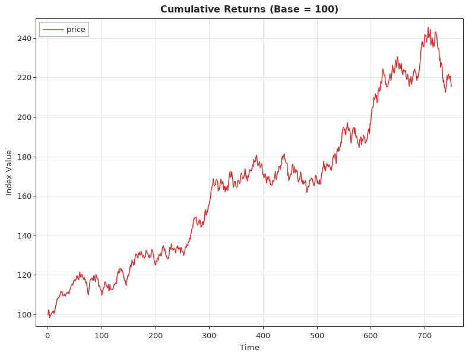
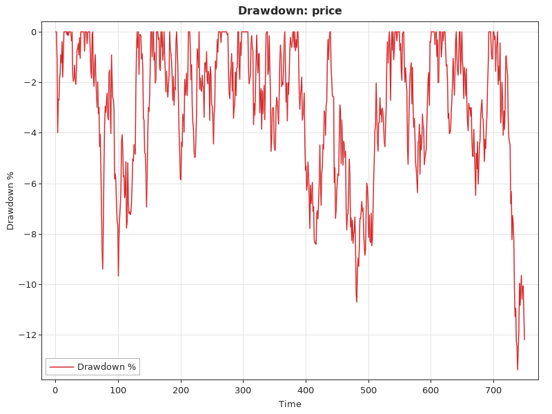
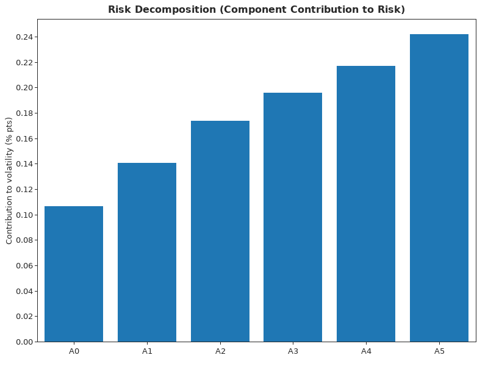

# The `finance` package, part 5: portfolio construction and risk analytics

This is the fifth part of the guide to `wotan/finance`. [Parts 1–4](finance_options_guide.md) cover derivatives, curves and credit; this part turns to portfolios. It covers:
- mean-variance portfolios in closed form: minimum variance, maximum Sharpe ratio, risk aversion and the efficient frontier;
- constrained portfolios: long-only, position limits and group limits, with any convex objective;
- Black–Litterman: equilibrium returns, views and the posterior;
- estimating inputs from returns history: means, sample and EWMA covariances;
- CVaR: historical and EVT estimates, Euler contributions and the minimum-CVaR portfolio;
- risk parity, risk budgets and the decomposition of portfolio volatility;
- factor models: principal-axis factor analysis, varimax rotation, scores, the market factor and time-series factor covariances;
- rolling analytics on DataFrames, and charts.

Every example was compiled and run against the current code, and the output shown is the real output. The results agree with SciPy (SLSQP, `linprog`), NumPy, statsmodels and pandas; section 10 lists the comparisons. A debug build with a tracking allocator reports no leaks for any of the examples.

## Contents

1. [Setup and conventions](#1-setup-and-conventions)
2. [Mean-variance portfolios](#2-mean-variance-portfolios)
3. [Constrained portfolios](#3-constrained-portfolios)
4. [Black–Litterman](#4-blacklitterman)
5. [Inputs from returns history](#5-inputs-from-returns-history)
6. [CVaR](#6-cvar)
7. [Risk parity and risk decomposition](#7-risk-parity-and-risk-decomposition)
8. [Factor models](#8-factor-models)
9. [Rolling analytics and charts](#9-rolling-analytics-and-charts)
10. [Validation](#10-validation)
11. [Quick reference](#11-quick-reference)

## 1. Setup and conventions

```odin
import w "wotan/core"
import fin "wotan/finance"
import l "wotan/linalg"
```

The conventions in this part:
- **Data.** Weights and expected returns are `[]f64`. Covariances are `l.Matrix(f64)` (n × n, row-major `data`). Returns histories are `l.Matrix(f64)` with one row per period and one column per asset. The factor procedures take `[][]f64` with one row per observation.
- **Results.** Procedures that return weights allocate them; free them with `delete`. Result structs have free procedures:
  - `black_litterman_result_free`;
  - `factor_analysis_free`;
  - `risk_decomposition_free`;
  - `risk_decomp_free`;
  - `destroy_factor_model_covariance`.
- **Units.** Rates and volatilities are per period of the data: annual in sections 2–4, daily in sections 5–9. `annualize_return` and `annualize_volatility` scale daily figures by 252 and √252.

Sections 2–4 use five assets: two bond-like and three equity-like, with annual expected returns, volatilities and a correlation matrix.

```odin
// five assets: two bond-like, three equity-like; annual figures
mu := []f64{0.03, 0.04, 0.07, 0.08, 0.11}
vol := []f64{0.04, 0.06, 0.15, 0.18, 0.25}
corr := [25]f64 {
	1.0, 0.7, 0.1, 0.0, -0.1,
	0.7, 1.0, 0.2, 0.1, 0.0,
	0.1, 0.2, 1.0, 0.7, 0.6,
	0.0, 0.1, 0.7, 1.0, 0.7,
	-0.1, 0.0, 0.6, 0.7, 1.0,
}

cov := l.matrix_new(f64, 5, 5)
defer l.matrix_free(&cov)
for i in 0 ..< 5 {for j in 0 ..< 5 {cov.data[i * 5 + j] = corr[i * 5 + j] * vol[i] * vol[j]}}
```

## 2. Mean-variance portfolios

These procedures are fully invested (Σw = 1) and allow short sales, so each has a closed form. Write x = Σ⁻¹1 and y = Σ⁻¹μ; the solutions are combinations of the two.

| Procedure | Problem | Solution |
|---|---|---|
| `min_variance_portfolio(&cov)` | min wᵀΣw | x / 1ᵀx |
| `max_sharpe_portfolio(mu, &cov, rf)` | max (wᵀμ − rf) / σ(w) | Σ⁻¹(μ − rf) / 1ᵀΣ⁻¹(μ − rf) |
| `risk_aversion_portfolio(mu, &cov, gamma)` | max wᵀμ − (γ/2) wᵀΣw | (1/γ) Σ⁻¹ [μ − ((1ᵀy − γ)/1ᵀx) 1] |
| `efficient_frontier(mu, &cov, rf, n_points)` | min wᵀΣw with wᵀμ = t | from the minimum-variance return up to the highest single-asset return |

They panic if Σ is not positive definite. `portfolio_metrics(w, mu, &cov, rf)` gives the return, volatility and Sharpe ratio; `portfolio_return`, `portfolio_volatility` and `sharpe_ratio` give them one at a time.

```odin
gmv := fin.min_variance_portfolio(&cov)
defer delete(gmv)
tan := fin.max_sharpe_portfolio(mu, &cov, 0.02)
defer delete(tan)
ra := fin.risk_aversion_portfolio(mu, &cov, 4)
defer delete(ra)
for name, k in ([]string{"min variance", "max Sharpe (rf 2%)", "risk aversion 4"}) {
	wts := ([][]f64{gmv, tan, ra})[k]
	m := fin.portfolio_metrics(wts, mu, &cov, 0.02)
	fmt.printf("%-19s %.6f  return %.6f vol %.6f Sharpe %.6f\n", name, wts, m.expected_return, m.volatility, m.sharpe_ratio)
}
bad := fin.max_sharpe_portfolio(mu, &cov, 0.05)
defer delete(bad)
fmt.println("max Sharpe with rf above the min-variance return:", bad)
fr := fin.efficient_frontier(mu, &cov, 0.02, 5)
defer {for p in fr {delete(p.weights)}; delete(fr)}
for p in fr {fmt.printf("frontier: return %.4f vol %.6f Sharpe %.6f\n", p.expected_return, p.volatility, p.sharpe_ratio)}
```

```
min variance        [1.020239, -0.067581, -0.003888, 0.019651, 0.031579]  return 0.032677 vol 0.038535 Sharpe 0.328988
max Sharpe (rf 2%)  [0.302489, 0.476134, 0.039717, 0.045260, 0.136401]  return 0.049525 vol 0.058807 Sharpe 0.502063
risk aversion 4     [-0.511690, 1.092896, 0.089180, 0.074309, 0.255305]  return 0.068636 vol 0.102345 Sharpe 0.475215
max Sharpe with rf above the min-variance return: [NaN, NaN, NaN, NaN, NaN]
frontier: return 0.0327 vol 0.038535 Sharpe 0.328988
frontier: return 0.0520 vol 0.063897 Sharpe 0.500930
frontier: return 0.0713 vol 0.108980 Sharpe 0.471083
frontier: return 0.0907 vol 0.157691 Sharpe 0.448151
frontier: return 0.1100 vol 0.207490 Sharpe 0.433756
```

The unconstrained solutions are extreme. The minimum-variance portfolio holds 102% of the first bond and shorts the second, because the two are 70% correlated and the first is less volatile. The risk-aversion portfolio is short 51% of one bond to buy the other.

No frontier point beats the tangency portfolio's Sharpe ratio of 0.502.

When rf is at or above the minimum-variance portfolio's return (3.27% here), no portfolio maximizes the Sharpe ratio: the formula would give the minimum instead. In that case the weights are NaN.

## 3. Constrained portfolios

`PortfolioConstraints` describes a convex feasible set; weights always sum to 1:
- `no_short_selling`: w ≥ 0;
- `max_weight` and `min_weight`: per-asset bounds, with 0 meaning no limit. `min_weight` applies to every asset, as there is no "only if held";
- `group_limits`: a list of `GroupLimit{asset_indices, max_weight}`, capping the sum of a group's weights.

The optimizers minimize their objective by spectral projected gradient: Barzilai–Borwein steps with a non-monotone line search. Every step is projected exactly onto the feasible set. Variance and the utility are convex, and the negative Sharpe ratio is pseudoconvex where the excess return is positive, so a stationary point is the global optimum. The procedures:

| Procedure | Problem |
|---|---|
| `constrained_min_variance_portfolio(&cov, c)` | min wᵀΣw |
| `constrained_max_sharpe_portfolio(mu, &cov, rf, c)` | max Sharpe ratio |
| `constrained_mean_variance_portfolio(mu, &cov, target, c)` | min wᵀΣw with wᵀμ = target, met exactly |
| `constrained_risk_aversion_portfolio(mu, &cov, gamma, c)` | max wᵀμ − (γ/2) wᵀΣw |
| `constrained_minimize(n, f, grad, user, c, init = nil)` | any objective with its gradient; global for convex f |
| `project_constraints(v, c)`, `enforce_constraints` | the nearest feasible weights |

Each takes `allocator` and accepts `max_iter` and `tol`.

Below, the portfolio is long-only, each asset is capped at 40%, and the two bonds together at 50%:

```odin
// constraints: long only, at most 40% per asset, bonds (0, 1) together at most 50%
c := fin.PortfolioConstraints {
	no_short_selling = true,
	max_weight       = 0.4,
	group_limits     = []fin.GroupLimit{{asset_indices = []int{0, 1}, max_weight = 0.5}},
}
cmv := fin.constrained_min_variance_portfolio(&cov, c, context.allocator)
defer delete(cmv)
cms := fin.constrained_max_sharpe_portfolio(mu, &cov, 0.02, c, context.allocator)
defer delete(cms)
ctr := fin.constrained_mean_variance_portfolio(mu, &cov, 0.08, c, context.allocator)
defer delete(ctr)
cra := fin.constrained_risk_aversion_portfolio(mu, &cov, 4, c, context.allocator)
defer delete(cra)
for name, k in ([]string{"min variance", "max Sharpe", "target 8%", "risk aversion 4"}) {
	wts := ([][]f64{cmv, cms, ctr, cra})[k]
	m := fin.portfolio_metrics(wts, mu, &cov, 0.02)
	fmt.printf("constrained %-16s %.6f  return %.6f vol %.6f\n", name, wts, m.expected_return, m.volatility)
}
proj := fin.project_constraints([]f64{0.5, 0.3, -0.1, 0.2, 0.1}, c, context.allocator)
defer delete(proj)
fmt.printf("nearest feasible to [0.5 0.3 -0.1 0.2 0.1]: %.6f\n", proj)
```

```
constrained min variance     [0.400000, 0.100000, 0.376491, 0.123509, 0.000000]  return 0.052235 vol 0.078807
constrained max Sharpe       [0.100000, 0.400000, 0.208946, 0.103195, 0.187859]  return 0.062546 vol 0.091868
constrained target 8%        [0.000000, 0.256134, 0.175465, 0.168401, 0.400000]  return 0.080000 vol 0.143603
constrained risk aversion 4  [0.100000, 0.400000, 0.164315, 0.092971, 0.242714]  return 0.064638 vol 0.096838
nearest feasible to [0.5 0.3 -0.1 0.2 0.1]: [0.350000, 0.150000, 0.000000, 0.300000, 0.200000]
```

Binding constraints are hit exactly:
- In the minimum-variance portfolio, the 40% cap binds on the first bond and the 50% bond limit on the pair.
- The target-return portfolio earns exactly 8.0000%.

SciPy's SLSQP (best of 20 starts) gives the same weights to 6 decimals.

A custom objective needs a value and a gradient. The example below minimizes tracking error to an equal-weight benchmark, with each asset at most 30% and the equities at most 50%. Both the value and the gradient are scaled by 100, because `tol` applies to the projected-gradient step and the objective should be of order 1.

```odin
// a custom objective: tracking error to a 60/40-like benchmark
Ctx :: struct {cov: ^l.Matrix(f64), bench: []f64}
ctx := Ctx{&cov, []f64{0.2, 0.2, 0.2, 0.2, 0.2}}
te :: proc(wts: []f64, user: rawptr) -> f64 {
	c := (^Ctx)(user)
	d: [5]f64
	for i in 0 ..< 5 {d[i] = wts[i] - c.bench[i]}
	return 100 * fin.portfolio_variance(d[:], c.cov)
}
te_grad :: proc(wts, g: []f64, user: rawptr) {
	c := (^Ctx)(user)
	d: [5]f64
	for i in 0 ..< 5 {d[i] = wts[i] - c.bench[i]}
	gv := fin.portfolio_variance_gradient(d[:], c.cov, context.temp_allocator)
	for i in 0 ..< 5 {g[i] = 100 * gv[i]}
}
c2 := c
c2.max_weight = 0.3
c2.group_limits = []fin.GroupLimit{{asset_indices = []int{2, 3, 4}, max_weight = 0.5}}
tw := fin.constrained_minimize(5, te, te_grad, &ctx, c2, context.allocator)
defer delete(tw)
fmt.printf("min tracking error to equal weights, equities <= 50%%: %.6f  TE %.6f\n", tw, sqrt_te(tw, ctx.bench, &cov))
```

`sqrt_te` is a small helper: √((w − b)ᵀΣ(w − b)), computed with `portfolio_volatility`. `sum`, used in section 4, adds up a slice.

```
min tracking error to equal weights, equities <= 50%: [0.239481, 0.260519, 0.113797, 0.173578, 0.212626]  TE 0.014570
```

The benchmark holds 60% in equities, so the 50% limit forces a tracking error of 1.46%. The optimizer takes most of the cut from asset 2, the equity most correlated with the bonds, and even adds a little to asset 4.

The building blocks are public:
- `portfolio_variance` and `portfolio_variance_gradient`;
- `negative_sharpe` and `negative_sharpe_gradient`;
- `project_simplex` (the probability simplex);
- `project_box` and `project_groups`. These are simple clips that don't keep Σw = 1.

## 4. Black–Litterman

Black–Litterman blends a prior with views:
- **Prior.** The prior is the excess returns implied by the market portfolio: Π = δ Σ w_mkt (`bl_implied_returns`). The risk aversion δ = (E[R_m] − r_f) / σ_m² comes from `bl_market_risk_aversion`.
- **Views.** Views are P μ = Q + ε, with ε ~ N(0, Ω). Each row of P is a view: one asset, or a spread between assets.
- **Posterior.** `black_litterman(&cov, prior, &P, Q, tau = 0.05, omega = nil, confidences = nil)` returns μ_BL, Σ_BL = Σ + M (M is the uncertainty of the mean) and the Ω it used (He & Litterman 1999).
- **View uncertainty.** Ω defaults to He–Litterman's diag(P τΣ Pᵀ). With Idzorek `confidences` c ∈ [0, 1], each view's ω is (1/c − 1) p τΣ pᵀ: at 100% the view holds exactly, at 0% it is ignored.
- **Weights.** `bl_optimal_weights(&cov, mu, delta)` gives the unconstrained weights (δΣ)⁻¹μ. The posterior can also go straight into the optimizers of sections 2 and 3.

```odin
// Black-Litterman: market weights, implied returns, two views
w_mkt := []f64{0.25, 0.15, 0.25, 0.20, 0.15}
m_var := fin.portfolio_volatility(w_mkt, &cov)
delta := fin.bl_market_risk_aversion(0.065, m_var * m_var, 0.02)
pi := fin.bl_implied_returns(&cov, w_mkt, delta)
defer delete(pi)
fmt.printf("delta %.6f  implied excess returns %.6f\n", delta, pi)
P := l.matrix_new(f64, 2, 5)
defer l.matrix_free(&P)
copy(P.data, []f64{0, 0, 0, 0, 1, /* view 1: asset 4 returns 9% excess */ 0, 0, 1, -1, 0 /* view 2: 2 beats 3 by 1% */})
Q := []f64{0.09, 0.01}
bl := fin.black_litterman(&cov, pi, &P, Q)
defer fin.black_litterman_result_free(&bl)
fmt.printf("posterior (He-Litterman Omega) %.6f\n", bl.posterior_returns)
fmt.printf("omega diag %.8f %.8f, posterior cov[4][4] %.8f vs prior %.8f\n", bl.omega.data[0], bl.omega.data[3], bl.posterior_cov.data[24], cov.data[24])
wbl := fin.bl_optimal_weights(&bl.posterior_cov, bl.posterior_returns, delta)
defer delete(wbl)
fmt.printf("BL weights %.6f (sum %.6f)\n", wbl, sum(wbl))
full := fin.black_litterman(&cov, pi, &P, Q, confidences = []f64{1.0, 0.0})
defer fin.black_litterman_result_free(&full)
fmt.printf("confidences 100%%/0%%: %.6f  P·mu %.6f %.6f\n", full.posterior_returns,
	full.posterior_returns[4], full.posterior_returns[2] - full.posterior_returns[3])
```

```
delta 4.463046  implied excess returns [0.002910, 0.007257, 0.058912, 0.071819, 0.093947]
posterior (He-Litterman Omega) [0.003297, 0.007742, 0.061721, 0.063251, 0.088939]
omega diag 0.00312500 0.00085500, posterior cov[4][4] 0.06403232 vs prior 0.06250000
BL weights [0.238095, 0.142857, 0.383441, 0.045131, 0.153988] (sum 0.963511)
confidences 100%/0%: [0.002973, 0.007257, 0.057491, 0.069830, 0.090000]  P·mu 0.090000 -0.012339
```

Both views pull against the prior:
- The market implies 9.39% for asset 4, and the view says 9%; the posterior settles at 8.89%.
- The market implies that asset 2 trails asset 3 by 1.29%; the view says it leads by 1%. The posterior lowers the gap to 0.15%, and the weights move from asset 3 to asset 2.

The assets without views keep their market weights divided by 1 + τ (0.25/1.05 = 0.238095). That is the He–Litterman property, and it is why the weights sum to less than 1.

With Idzorek confidences of 100% and 0%, the first view holds exactly (9.0000%) and the second is ignored. The spread still moves from −1.29% to −1.23%, because the first view shifts correlated assets.

## 5. Inputs from returns history

Sections 5–9 use 750 days of simulated returns for six assets:
- a market factor with betas 0.6–1.4;
- a sector factor for assets 3–5;
- fat-tailed noise, Student-t with 5 degrees of freedom.

The procedures:
- `expected_returns_from_history(&R)` gives arithmetic means;
- `covariance_matrix(&R)` gives the sample covariance, with an n − 1 denominator;
- `garch_adjusted_covariance(&R, lambda = 0.94)` gives the RiskMetrics EWMA covariance, with zero mean and the most recent day weighted 1. Despite the name it is not fitted by GARCH: it is the RiskMetrics special case with a fixed λ.

```odin
T :: 750
N :: 6

// daily returns of 6 assets: a market factor, a sector factor for assets 3-5,
// fat-tailed noise (t(5)); rows = days, cols = assets
rand.reset(2026)
R := l.matrix_new(f64, T, N)
defer l.matrix_free(&R)
F := make([][]f64, T) // the two factors, for the factor model
defer {for f in F {delete(f)}; delete(F)}
beta := [N]f64{0.6, 0.8, 1.0, 1.1, 1.2, 1.4}
sect := [N]f64{0, 0, 0, 0.8, 1.0, 0.6}
for t in 0 ..< T {
	m := 0.0004 + 0.010 * rand.float64_normal(0, 1)
	s := 0.006 * rand.float64_normal(0, 1)
	F[t] = make([]f64, 2)
	F[t][0], F[t][1] = m, s
	for i in 0 ..< N {
		chi := 0.0
		for _ in 0 ..< 5 {g := rand.float64_normal(0, 1); chi += g * g}
		eps := 0.008 * rand.float64_normal(0, 1) / math.sqrt(chi / 5) * math.sqrt(3.0 / 5.0)
		R.data[t * N + i] = beta[i] * m + sect[i] * s + eps
	}
}

mu := fin.expected_returns_from_history(&R)
defer delete(mu)
cov := fin.covariance_matrix(&R)
defer l.matrix_free(&cov)
ew := fin.garch_adjusted_covariance(&R, 0.94)
defer l.matrix_free(&ew)
fmt.printf("mean daily returns %.8f\n", mu)
fmt.printf("annualised: return %.6f vol %.6f (asset 0)\n", fin.annualize_return(mu[0]), fin.annualize_volatility(math.sqrt(cov.data[0])))
fmt.printf("sample var %.10f %.10f  EWMA var %.10f %.10f\n", cov.data[0], cov.data[N * N - 1], ew.data[0], ew.data[N * N - 1])
```

```
mean daily returns [0.00073227, 0.00049415, 0.00061214, 0.00146373, 0.00194586, 0.00131113]
annualised: return 0.184532 vol 0.156789 (asset 0)
sample var 0.0000975504 0.0002728212  EWMA var 0.0001037378 0.0003734447
```

Three years of daily data estimate means poorly. Asset 0 earned 18% a year in this sample, though its expected return is 0.6 × 0.04% × 252 ≈ 6%. That error is why Black–Litterman priors and the risk-based portfolios below are popular.

The EWMA variances weight the last few months most, so they move away from the full-sample values whenever recent volatility differs.

## 6. CVaR

CVaR is reported as a positive loss:
- `portfolio_returns(w, &R)` gives the portfolio's return history.
- `portfolio_cvar_historical(returns, confidence)` is the Acerbi–Tasche mean of the worst (1 − confidence) share of returns, weighting the boundary observation by its fractional part.
- `portfolio_cvar_evt(returns, confidence)` fits a generalized Pareto tail above the confidence quantile.

`cvar_gradient(w, &R, confidence)` is the gradient of CVaR with respect to the weights. CVaR is homogeneous of degree 1, so wᵢ·gradᵢ are the Euler contributions, and they sum to the CVaR. `cvar_scenario_weights` gives each scenario's weight in the tail average.

`min_cvar_portfolio(&R, constraints, confidence)` minimizes historical CVaR under constraints. It uses Rockafellar–Uryasev's convex formulation, smoothed and solved by accelerated projected gradient, with the smoothing driven down to 1e-9 of the return scale. `portfolio_metrics_with_cvar` adds the 95% and 99% CVaR to the usual metrics.

```odin
// CVaR
eq := []f64{1.0 / 6, 1.0 / 6, 1.0 / 6, 1.0 / 6, 1.0 / 6, 1.0 / 6}
pr := fin.portfolio_returns(eq, &R, context.allocator)
defer delete(pr)
cv95 := fin.portfolio_cvar_historical(pr, 0.95)
fmt.printf("equal weights: CVaR95 %.10f CVaR99 %.10f EVT CVaR95 %.10f\n", cv95, fin.portfolio_cvar_historical(pr, 0.99), fin.portfolio_cvar_evt(pr, 0.95, context.allocator))
g := fin.cvar_gradient(eq, &R, 0.95, context.allocator)
defer delete(g)
euler := 0.0
for x, i in g {euler += eq[i] * x}
fmt.printf("CVaR gradient %.8f, sum w*grad %.10f\n", g, euler)
lo := fin.PortfolioConstraints{no_short_selling = true, max_weight = 0.4}
mc := fin.min_cvar_portfolio(&R, lo, 0.95, context.allocator)
defer delete(mc)
pm := fin.portfolio_returns(mc, &R, context.allocator)
defer delete(pm)
fmt.printf("min CVaR95 (long only, <= 40%%): %.6f  CVaR %.10f\n", mc, fin.portfolio_cvar_historical(pm, 0.95))
m := fin.portfolio_metrics_with_cvar(mc, mu, &R, &cov, 0, context.allocator)
fmt.printf("  metrics: return %.8f vol %.8f CVaR95 %.8f CVaR99 %.8f\n", m.expected_return, m.volatility, m.cvar_95, m.cvar_99)
```

```
equal weights: CVaR95 0.0215981486 CVaR99 0.0290702657 EVT CVaR95 0.0216223868
CVaR gradient [0.01321436, 0.01712679, 0.02134076, 0.02470534, 0.02496592, 0.02823572], sum w*grad 0.0215981486
min CVaR95 (long only, <= 40%): [0.400000, 0.379392, 0.129975, 0.000000, 0.090633, 0.000000]  CVaR 0.0185448449
  metrics: return 0.00073631 vol 0.00906101 CVaR95 0.01854484 CVaR99 0.02472706
```

On a bad day (one in twenty), the equal-weight portfolio loses 2.16% on average. The Euler contributions add up to exactly that.

The minimum-CVaR portfolio puts most of its weight in the two low-beta assets: 40% at the cap and 38%. Its CVaR, 1.8545%, is the optimum of the exact linear program (SciPy `linprog`) to 2e-10.

## 7. Risk parity and risk decomposition

`risk_contributions(w, &cov)` gives wᵢ(Σw)ᵢ/σ, which sums to the portfolio volatility σ. `risk_decomposition(w, &cov)` returns a `RiskDecomp` with the total risk, the marginal contributions ∂σ/∂wᵢ (MCTR) and the components wᵢ·MCTRᵢ (CTR). Free it with `risk_decomp_free`.

`risk_parity_portfolio(&cov, constraints, budgets = nil)` builds a long-only portfolio in which every asset contributes the same share of the volatility. With `budgets`, each asset contributes its budget share bᵢ instead.

It solves by cyclical coordinate descent on ½yᵀΣy − Σ bᵢ ln yᵢ (Griveau-Billion, Richard & Roncalli 2013). The constraints are applied afterwards, by projection. With binding bounds the contributions are then no longer equal.

```odin
// risk parity
rp := fin.risk_parity_portfolio(&cov, {no_short_selling = true}, context.allocator)
defer delete(rp)
rc := fin.risk_contributions(rp, &cov, context.allocator)
defer delete(rc)
fmt.printf("risk parity %.6f\n  contributions %.8f\n", rp, rc)
rb := fin.risk_parity_portfolio(&cov, {no_short_selling = true}, context.allocator, budgets = []f64{0.3, 0.3, 0.1, 0.1, 0.1, 0.1})
defer delete(rb)
rcb := fin.risk_contributions(rb, &cov, context.allocator)
defer delete(rcb)
tot := 0.0
for x in rcb {tot += x}
fmt.printf("budgets 30/30/10/10/10/10: %.6f  shares %.6f\n", rb, []f64{rcb[0] / tot, rcb[1] / tot, rcb[2] / tot, rcb[3] / tot, rcb[4] / tot, rcb[5] / tot})
d := fin.risk_decomposition(eq, &cov)
defer fin.risk_decomp_free(&d)
fmt.printf("equal weights: vol %.8f MCTR %.6f CTR %.8f\n", d.total_risk, d.mctr, d.ctr)
```

```
risk parity [0.243591, 0.194451, 0.161880, 0.146825, 0.133302, 0.119950]
  contributions [0.00168771, 0.00168771, 0.00168771, 0.00168771, 0.00168771, 0.00168771]
budgets 30/30/10/10/10/10: [0.362829, 0.300735, 0.096029, 0.088591, 0.080218, 0.071598]  shares [0.300000, 0.300000, 0.100000, 0.100000, 0.100000, 0.100000]
equal weights: vol 0.01075374 MCTR [0.006391, 0.008433, 0.010438, 0.011746, 0.013006, 0.014509] CTR [0.00106512, 0.00140548, 0.00173971, 0.00195761, 0.00216770, 0.00241812]
```

Risk parity holds less of the high-beta assets, and every contribution is 0.168771% of daily volatility. Under equal weights, by contrast, the riskiest asset contributes more than twice as much as the safest. The CTR values add up to the 1.0754% daily volatility.

## 8. Factor models

Section 8 continues the program of section 5, with the returns as rows:

```odin
rows := make([][]f64, T)
defer delete(rows)
for t in 0 ..< T {rows[t] = R.data[t * N:(t + 1) * N]}
```

**Statistical factors.**
- `factor_analysis(rows, n_factors)` is principal-axis factoring of the correlation matrix, as R's `psych::fa(fm = "pa")`. It starts from the squared multiple correlations and iterates the communalities. It returns `loadings[f][v]`, communalities, uniquenesses and eigenvalues (the sum of squared loadings per factor). Free it with `factor_analysis_free`.
- `varimax_rotation(loadings)` rotates the loadings, with Kaiser normalization (R's default).
- `compute_factor_scores(rows, &fa)` gives regression (Thurstone) scores.
- `extract_market_factor(rows)` returns the first principal component's scores, signed to load positively, and the share of variance it explains.
- `decompose_risk(rows, n_factors)` reports the same split per asset as a `RiskDecomposition`. Free it with `risk_decomposition_free`.
- `factor_analysis_df` and `compute_factor_scores_df` read DataFrame columns.

**Time-series factor model.** `factor_model_covariance(rows, factor_rows)` regresses each asset on observed factors. It returns:
- the OLS betas and the residual variances;
- Σ_model = B Σ_f Bᵀ + D;
- the sample covariance, for comparison.

Free the result with `destroy_factor_model_covariance`.

```odin
fa := fin.factor_analysis(rows, 2)
fmt.printf("factor analysis: converged %v after %d, eigenvalues %.6f\n", fa.converged, fa.n_iterations, fa.eigenvalues)
fmt.printf("  loadings f1 %.6f\n  loadings f2 %.6f\n  communalities %.6f\n", fa.loadings[0], fa.loadings[1], fa.communalities)
rot := fin.varimax_rotation(fa.loadings)
fmt.printf("varimax f1 %.6f\n        f2 %.6f\n", rot[0], rot[1])
sc := fin.compute_factor_scores(rows, &fa)
fmt.printf("scores day 0 %.6f day 1 %.6f\n", sc[0], sc[1])
mk, ve := fin.extract_market_factor(rows)
fmt.printf("market factor: variance explained %.6f, scores %.6f %.6f\n", ve, mk[0], mk[1])
fm := fin.factor_model_covariance(rows, F)
defer fin.destroy_factor_model_covariance(&fm, context.allocator)
fmt.printf("factor model betas %.6f / %.6f\n  idiosyncratic var %.10f\n  cov[3][4] model %.10f sample %.10f\n",
	fm.betas[0], fm.betas[4], fm.idiosyncratic_var, fm.reconstructed_cov[3][4], fm.sample_cov[3][4])
fin.factor_analysis_free(&fa)
for x in ([][][]f64{rot, sc}) {for r in x {delete(r)}; delete(x)}
delete(mk)
```

```
factor analysis: converged true after 77, eigenvalues [3.478971, 0.144518]
  loadings f1 [0.578048, 0.689395, 0.769002, 0.823149, 0.826265, 0.847298]
  loadings f2 [-0.169143, -0.189623, -0.130180, 0.197380, 0.145177, 0.054501]
  communalities [0.362749, 0.511223, 0.608310, 0.716533, 0.703790, 0.720885]
varimax f1 [0.306725, 0.374073, 0.472819, 0.736080, 0.702703, 0.656140]
        f2 [-0.518332, -0.609337, -0.620284, -0.417994, -0.458255, -0.538855]
scores day 0 [0.643840, -0.336667] day 1 [2.089760, -0.279346]
market factor: variance explained 0.641420, scores 1.293066 4.480548
factor model betas [0.601218, -0.097796] / [1.225717, 0.922468]
  idiosyncratic var [0.0000620994, 0.0000645116, 0.0000632624, 0.0000587760, 0.0000626759, 0.0000780215]
  cov[3][4] model 0.0001498052 sample 0.0001496868
```

The statistical factors find the structure that was simulated:
- The first factor is the market, loading on every asset. The second contrasts assets 3–5 (the sector) with assets 0–2.
- After varimax, the first factor carries the sector assets and the second the rest.
- Each factor's sign is arbitrary: an implementation may flip any factor.

The time-series model recovers the simulated betas: 0.60 and −0.10 for asset 0 (true 0.6 and 0), and 1.23 and 0.92 for asset 4 (true 1.2 and 1.0). Its covariance of assets 3 and 4 matches the sample to within 0.1%.

## 9. Rolling analytics and charts

The rolling functions take a `w.DataFrame` and return a `w.Column`, which `w.destroy_column` frees. Windows that are not yet full, or have too few values, give null.

| Procedure | Result |
|---|---|
| `rolling_sharpe(&df, col, window, rf_annual = 0, periods = 252)` | annualized mean / standard deviation of the excess returns |
| `rolling_beta(&df, col, bench, window)` | OLS beta over the rows where both columns are present |
| `rolling_volatility(&df, col, window, min_periods)` | annualized rolling standard deviation, as pandas `rolling().std()` |
| `ewma_rolling_volatility(&df, col, alpha, min_periods)` | as pandas `ewm(alpha, adjust=False).std()`, annualized |
| `rolling_corr_matrix`, `rolling_cov_matrix`, `ewm_cov_matrix` | long-format DataFrames of pairwise statistics (from the analytics package) |

The charts write PNG files using the plot package:
- `plot_cumulative_returns(&df, price_cols, path)` rebases each column to 100;
- `plot_drawdown(&df, price_col, path)`;
- `plot_risk_decomposition(decomp, names, path)` draws the CTR in volatility percentage points.

```odin
// rolling analytics on a DataFrame: equal-weight portfolio vs asset 0 as benchmark
df := w.dataframe_new()
defer w.destroy_dataframe(&df)
pc := w.column_new("port", .Float, T)
bc := w.column_new("bench", .Float, T)
px := w.column_new("price", .Float, T)
level := 100.0
for t in 0 ..< T {
	w.append_float(&pc, pr[t])
	w.append_float(&bc, R.data[t * N])
	level *= 1 + pr[t]
	w.append_float(&px, level)
}
w.add_column(&df, pc)
w.add_column(&df, bc)
w.add_column(&df, px)
rs := fin.rolling_sharpe(&df, "port", 60)
defer w.destroy_column(&rs)
rbt := fin.rolling_beta(&df, "port", "bench", 60)
defer w.destroy_column(&rbt)
rv := fin.rolling_volatility(&df, "port", 60, 60)
defer w.destroy_column(&rv)
ev := fin.ewma_rolling_volatility(&df, "port", 0.06, 20)
defer w.destroy_column(&ev)
for t in ([]int{58, 59, 300, T - 1}) {
	a, an := w.column_at_float(&rs, t)
	b, bn := w.column_at_float(&rbt, t)
	c, cn := w.column_at_float(&rv, t)
	e, en := w.column_at_float(&ev, t)
	fmt.printf("day %3d: sharpe %v beta %v vol %v ewma vol %v\n", t, a if !an else math.nan_f64(), b if !bn else math.nan_f64(), c if !cn else math.nan_f64(), e if !en else math.nan_f64())
}
fmt.println("plots:", fin.plot_cumulative_returns(&df, []string{"price"}, "docs/images/finance_cumulative.png"),
	fin.plot_drawdown(&df, "price", "docs/images/finance_drawdown.png"),
	fin.plot_risk_decomposition(d, []string{"A0", "A1", "A2", "A3", "A4", "A5"}, "docs/images/finance_risk_decomposition.png"))
```

```
day  58: sharpe NaN beta NaN vol NaN ewma vol 0.12706730800371202
day  59: sharpe 5.934941762534241 beta 0.4686035751445583 vol 0.14642565077669475 ewma vol 0.13224231094988947
day 300: sharpe 4.217299864086445 beta 0.6887984116293049 vol 0.1630951178798898 ewma vol 0.1663722897640044
day 749: sharpe -0.6323437705463887 beta 0.9287115554466012 vol 0.1929874772171933 ewma vol 0.17740969169422727
```

The 60-day windows start on day 59, while the EWMA volatility needs only 20 days. pandas gives the same numbers to the last digit or two.







## 10. Validation

**Reference tests in the suite:**

| Test | Compares |
|---|---|
| `portfolio_reference_test` | closed-form portfolios and the frontier |
| `constraints_reference_test`, `optimizers_reference_test` | constrained portfolios and projections against SciPy |
| `black_litterman_hrp_reference_test`, `hrp_test` | Black–Litterman, including Idzorek confidences; hierarchical risk parity |
| `risk_portfolio_reference_test` | CVaR estimators and gradients, minimum CVaR, risk parity |
| `factors_reference_test`, `factor_model_test`, `factor_analysis_test` | principal-axis factoring, varimax, scores, factor model covariance |
| `finance_analytics_reference_test`, `finance_analytics_test`, `analytics_edge_cases_test`, `analytics_memory_test` | rolling analytics against pandas, edge cases, memory |

**Additional checks while writing this guide:**

| What | Reference | Agreement |
|---|---|---|
| minimum variance, tangency, risk aversion, frontier | NumPy closed forms | 6 printed decimals |
| constrained minimum variance, max Sharpe, target return, utility, projection, tracking error | SciPy SLSQP, best of 20 starts | 3e-7 |
| Black–Litterman posterior, Ω, Σ_BL, weights, Idzorek 100% / 0% | NumPy formulas | all printed digits |
| means, sample and EWMA covariance, historical CVaR | NumPy | all printed digits |
| minimum CVaR | SciPy `linprog` on the Rockafellar–Uryasev LP | CVaR 2e-10, weights 2e-5 |
| risk parity and budgets | SciPy L-BFGS-B on the log-barrier problem | 1e-6 |
| factor analysis, varimax, scores, market factor | NumPy principal-axis / R-style varimax | 1e-6; varimax 2e-5 (its default tolerance is 1e-6) |
| factor model betas, residual variances, model covariance | NumPy / OLS | all printed digits |
| rolling Sharpe, beta, volatility, EWMA volatility | pandas | 1e-15 relative |

**Fixed while writing this guide:**
- **Constrained portfolios with group limits.** The projection onto the constraints combines group limits with the box and budget by Dykstra's alternating projections. It stopped as soon as the point stopped moving between sweeps. After a long gradient step the box clamps saturate, so the point can stay put while Dykstra's correction terms still drift towards the true projection. The result was a wrong projection:
  - the minimum-variance portfolio broke the group limit, putting 80% in the bonds against a 50% limit;
  - the max-Sharpe and utility optimizers stopped at their equal-weight start.

  The iteration now stops only when the correction terms have settled as well. All three match SciPy, and `min_cvar_portfolio` and `risk_parity_portfolio`, which use the same projection, are covered too. `finance_fixes_test` checks this against SciPy and fails on the previous code.
- **API.** The constraint, CVaR and risk-parity procedures now default `allocator` to `context.allocator`, like the rest of the package. `factor_analysis_free`, `risk_decomposition_free` and `risk_decomp_free` are new; before, these results had to be freed field by field.

**Known limitations:**
- **Group limits.** Group limits are upper limits only.
- **min_weight.** `min_weight` applies to every asset; there is no "if held".
- **Long-only results.** `risk_parity_portfolio` is long-only, and `efficient_frontier` stops at the highest single-asset return.
- **Naming.** `garch_adjusted_covariance` is a RiskMetrics EWMA, not a fitted GARCH.

## 11. Quick reference

| Task | Procedure | Section |
|---|---|---|
| Portfolio metrics | `portfolio_return`, `portfolio_volatility`, `sharpe_ratio`, `portfolio_metrics`, `portfolio_variance` | 2–3 |
| Closed-form portfolios | `min_variance_portfolio`, `max_sharpe_portfolio`, `risk_aversion_portfolio`, `efficient_frontier` | 2 |
| Constrained portfolios | `constrained_min_variance_portfolio`, `constrained_max_sharpe_portfolio`, `constrained_mean_variance_portfolio`, `constrained_risk_aversion_portfolio`, `constrained_minimize` | 3 |
| Projections | `project_constraints`, `enforce_constraints`, `project_simplex`, `project_box`, `project_groups` | 3 |
| Black–Litterman | `bl_market_risk_aversion`, `bl_implied_returns`, `black_litterman`, `bl_optimal_weights`, `black_litterman_result_free` | 4 |
| Inputs from history | `expected_returns_from_history`, `covariance_matrix`, `garch_adjusted_covariance`, `annualize_return`, `annualize_volatility` | 5 |
| CVaR | `portfolio_returns`, `portfolio_cvar_historical`, `portfolio_cvar_evt`, `cvar_gradient`, `cvar_scenario_weights`, `min_cvar_portfolio`, `portfolio_metrics_with_cvar` | 6 |
| Risk budgeting | `risk_parity_portfolio`, `risk_contributions`, `risk_decomposition`, `risk_decomp_free` | 7 |
| Factor models | `factor_analysis`, `varimax_rotation`, `compute_factor_scores`, `extract_market_factor`, `decompose_risk`, `factor_model_covariance`, the `…_df` variants and the free procedures | 8 |
| Rolling analytics | `rolling_sharpe`, `rolling_beta`, `rolling_volatility`, `ewma_rolling_volatility`, `rolling_corr_matrix`, `rolling_cov_matrix`, `ewm_cov_matrix` | 9 |
| Charts | `plot_cumulative_returns`, `plot_drawdown`, `plot_risk_decomposition` | 9 |
