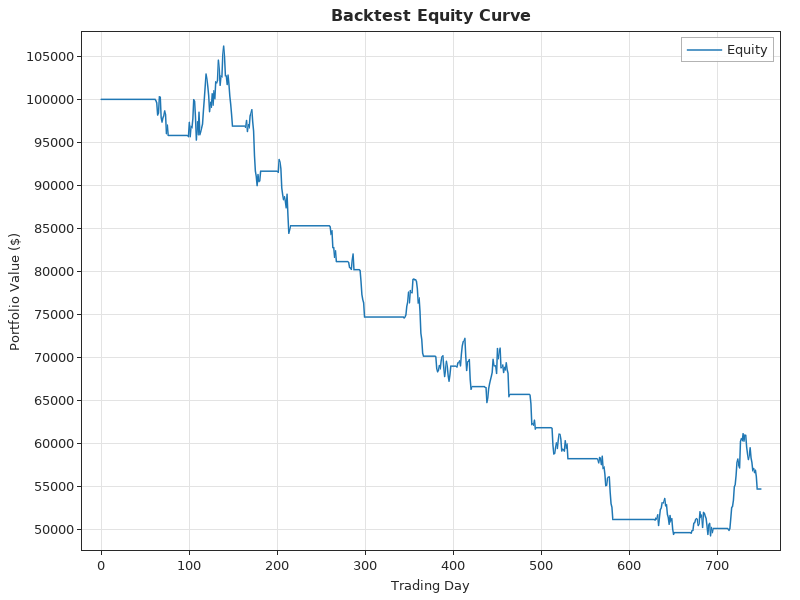

# The `finance` package, part 6: risk measurement, backtesting and market data

This is the last part of the guide to `wotan/finance`. [Parts 1–5](finance_options_guide.md) cover derivatives, curves, credit and portfolio construction. This part covers:
- value at risk and expected shortfall: historical, parametric and Monte Carlo;
- extreme value theory: generalized Pareto tails;
- GARCH-based risk: conditional VaR, GARCH-EVT, and VaR and ES backtests;
- performance and risk ratios: Sharpe, Sortino, Calmar, drawdowns, beta, tracking error and trade statistics;
- an event-driven backtester with commissions, slippage and short selling, with single-asset strategies and rebalanced portfolios;
- pricing with a stochastic discount factor (PDPM): utility and factor SDFs, state-price densities, and Dybvig's distributional price;
- market data: CSV loaders, and Yahoo price histories and option chains.

Every example was compiled and run against the current code, and the output shown is the real output. The results agree with NumPy, SciPy, the `arch` package, independent replays and closed forms; section 9 lists the comparisons. A debug build with a tracking allocator reports no leaks for any of the examples. The Yahoo example in section 8 fetches live data, so its numbers change from day to day.

## Contents

1. [Setup and sign conventions](#1-setup-and-sign-conventions)
2. [Value at risk and expected shortfall](#2-value-at-risk-and-expected-shortfall)
3. [Extreme value theory](#3-extreme-value-theory)
4. [GARCH risk and backtests](#4-garch-risk-and-backtests)
5. [Performance metrics](#5-performance-metrics)
6. [Backtesting strategies](#6-backtesting-strategies)
7. [Pricing with a stochastic discount factor](#7-pricing-with-a-stochastic-discount-factor)
8. [Market data](#8-market-data)
9. [Validation](#9-validation)
10. [Quick reference](#10-quick-reference)

## 1. Setup and sign conventions

```odin
import w "wotan/core"
import fin "wotan/finance"
import net "wotan/net"   // only for Yahoo
```

Returns are simple per-period returns in `[]f64`. Annualized figures assume 252 periods a year unless a `periods_per_year` argument says otherwise.

The risk measures use two sign conventions:

| Convention | Procedures |
|---|---|
| A **return quantile** (negative for a loss): "the 5% worst day loses 1.3%" is −0.013 | `var_historical`, `var_parametric`, `var_monte_carlo`, `value_at_risk`, `conditional_var`, `expected_shortfall`, `var_garch_single`, `cvar_garch`, `evt_fit`'s fields, `evt_var_es` |
| A **positive loss magnitude**: 0.013 | `var_garch`, `cvar_garch_series`, `historical_var_rolling`, `historical_cvar_rolling`, `garch_risk_metrics`' current VaR and CVaR, the `garch_evt_fit` series, and the inputs of `backtest_var` and `backtest_es` |

`portfolio_cvar_historical` (part 5) also reports a positive loss. Drawdowns are ≤ 0.

The examples in sections 2–5 use 2000 days from a GARCH(1,1) with Student-t(6) shocks (ω = 2e-6, α = 0.08, β = 0.90), and a benchmark that shares 70% of the moves:

```odin
// 2000 days from a GARCH(1,1) with Student-t(6) shocks: ω = 2e-6, α = 0.08, β = 0.90,
// plus a benchmark that shares 70% of the moves
rand.reset(7)
n := 2000
r := make([]f64, n)
b := make([]f64, n)
defer {delete(r); delete(b)}
h := 2e-6 / (1 - 0.98)
for t in 0 ..< n {
	chi := 0.0
	for _ in 0 ..< 6 {g := rand.float64_normal(0, 1); chi += g * g}
	z := rand.float64_normal(0, 1) / math.sqrt(chi / 6) * math.sqrt(4.0 / 6.0) // unit variance t(6)
	r[t] = 0.0003 + math.sqrt(h) * z
	b[t] = 0.7 * r[t] + 0.006 * rand.float64_normal(0, 1)
	h = 2e-6 + 0.08 * (r[t] - 0.0003) * (r[t] - 0.0003) + 0.90 * h
}
```

## 2. Value at risk and expected shortfall

The VaR estimators:
- `var_historical(returns, confidence)` is the empirical quantile: x₍⌈(1−c)n⌉₎, the lower empirical quantile.
- `var_parametric` is mean − z_c · standard deviation, a normal fit.
- `var_monte_carlo(returns, confidence, n_simulations, horizon)` simulates normal returns with the sample mean and volatility, summed over `horizon` periods.
- `value_at_risk(returns, confidence, method)` dispatches on a `VaRMethod`. Its `.GARCH` case is a zero-mean normal VaR from the average squared return; for a fitted GARCH use section 4.

`conditional_var` (also `expected_shortfall`) is the Acerbi–Tasche mean of the worst (1 − c) share of returns, with the boundary observation weighted by its fractional part.

```odin
// value at risk and expected shortfall (returns: negative numbers are losses)
fmt.printf("VaR95 historical %.8f parametric %.8f Monte Carlo %.8f\n", fin.var_historical(r, 0.95),
	fin.var_parametric(r, 0.95), fin.var_monte_carlo(r, 0.95, 100000))
fmt.printf("VaR99 historical %.8f  CVaR95 %.8f CVaR99 %.8f\n", fin.var_historical(r, 0.99),
	fin.conditional_var(r, 0.95), fin.conditional_var(r, 0.99))
```

```
VaR95 historical -0.01312683 parametric -0.01375869 Monte Carlo -0.01376568
VaR99 historical -0.02188755  CVaR95 -0.01895127 CVaR99 -0.02812172
```

At 95% the normal fit overstates the loss: a unit-variance t(6) has its 5% quantile at 1.59 standard deviations, not 1.65. The fat tails show further out, at 99% and in the expected shortfall.

The Monte Carlo VaR converges to the parametric one, because it simulates the same normal distribution.

## 3. Extreme value theory

`evt_fit(returns, threshold_percentile = 0.95)` takes the losses beyond the threshold quantile and fits a generalized Pareto distribution to them by maximum likelihood (shape ξ, scale β). It returns an `EVT_Result` with:
- the threshold and the parameters;
- the number of exceedances;
- `converged`;
- VaR and CVaR at 95% and 99%, which are empirical while the level lies inside the sample body.

`evt_var_es(&result, p)` extrapolates to any level p. `gpd_pdf`, `gpd_cdf`, `gpd_quantile` and `gpd_fit` are available on their own; they stay accurate as ξ → 0.

```odin
// extreme value theory: GPD on the losses beyond the 95% threshold
evt := fin.evt_fit(r, 0.95)
fmt.printf("EVT: threshold %.8f xi %.6f beta %.8f exceedances %d converged %v\n", evt.threshold, evt.xi, evt.beta, evt.n_exceedances, evt.converged)
v999, e999 := fin.evt_var_es(&evt, 0.999)
fmt.printf("  VaR99 %.8f CVaR99 %.8f  VaR99.9 %.8f ES99.9 %.8f\n", evt.var_99, evt.cvar_99, v999, e999)
fmt.printf("  GPD cdf(0.01) %.10f quantile(0.9) %.10f\n", fin.gpd_cdf(0.01, evt.xi, evt.beta), fin.gpd_quantile(0.9, evt.xi, evt.beta))
```

```
EVT: threshold -0.01301539 xi 0.013421 beta 0.00585612 exceedances 100 converged true
  VaR99 -0.02254298 CVaR99 -0.02860837  VaR99.9 -0.03653673 ES99.9 -0.04279248
  GPD cdf(0.01) 0.8151743696 quantile(0.9) 0.0136947223
```

The fit is the exact maximum-likelihood estimate. SciPy's `genpareto.fit` stops slightly short of it: it gives ξ = 0.013388, at a log-likelihood 1e-7 lower. Refining SciPy's estimate with Nelder–Mead lands on ξ = 0.0134209, as here.

The 99.9% VaR, −3.65%, lies beyond anything the 2000 days can measure directly; that extrapolation is what the tail fit is for.

## 4. GARCH risk and backtests

`garch_risk_metrics(returns, model_type = .GARCH, p, q, risk_free_rate)` does four things:
- fits a GARCH model to the demeaned returns, using the `analytics` GARCH (`.GARCH`, `.GJR_GARCH`, `.StudentT` or `.GED` errors);
- forecasts the next day's volatility;
- turns that into the current VaR and CVaR at 95% and 99%, as positive losses from the model's error distribution;
- backtests the fitted VaR in sample, skipping 100 warm-up days.

It also fills the usual `RiskMetrics` in `base`. `long_run_vol` is √(ω / (1 − persistence)), per period.

`garch_evt_fit(returns, threshold_percentile = 0.90)` is McNeil and Frey's two-step method: a GARCH(1,1)-t fit, then a GPD fitted to the standardized residuals' tail. It gives standardized loss quantiles and ES, and VaR series. Free `var_95_series` and `var_99_series`.

`var_garch` and `cvar_garch_series` turn any conditional-variance series into VaR and ES series.

The backtests:
- `backtest_var(returns, var_series, confidence)` counts breaches. Its Kupiec proportion-of-failures test is χ²(1), and `passes_test` means p > 0.05.
- `backtest_es(returns, var_series, es_series, confidence)` adds two expected-shortfall tests: McNeil–Frey's exceedance-residual t test, and Acerbi–Székely's Z2, which is about 0 under the null and has a 5% critical value of about −0.70.
- `historical_var_rolling` and `historical_cvar_rolling(returns, confidence, window)` give rolling historical VaR and ES from the previous `window` returns.

```odin
// GARCH risk: fit, one-day forecast, in-sample VaR backtests
g := fin.garch_risk_metrics(r, .StudentT)
fmt.printf("GARCH-t: omega %.4e alpha %.6f beta %.6f nu %.4f persistence %.6f converged %v\n", g.garch_omega, g.garch_alpha, g.garch_beta, g.garch_nu, g.garch_persistence, g.converged)
fmt.printf("  long-run vol %.6f current vol %.6f VaR95 %.6f VaR99 %.6f CVaR95 %.6f\n", g.long_run_vol, g.current_vol, g.current_var_95, g.current_var_99, g.current_cvar_95)
fmt.printf("  backtest 95%%: %d breaches of %d (expected %.1f), Kupiec %.4f p %.4f pass %v\n", g.backtest_95.n_breaches, g.backtest_95.n_obs, g.backtest_95.expected_breaches, g.backtest_95.kupiec_stat, g.backtest_95.kupiec_pvalue, g.backtest_95.passes_test)
fmt.printf("  backtest 99%%: %d breaches (expected %.1f), p %.4f\n", g.backtest_99.n_breaches, g.backtest_99.expected_breaches, g.backtest_99.kupiec_pvalue)
ge := fin.garch_evt_fit(r, 0.90)
defer {delete(ge.var_95_series); delete(ge.var_99_series)}
fmt.printf("GARCH-EVT: xi %.6f q95 %.6f q99 %.6f es99 %.6f, 99%% breaches %d (expected %.1f)\n", ge.evt_xi, ge.q_95, ge.q_99, ge.es_q_99, ge.backtest_99.n_breaches, ge.backtest_99.expected_breaches)

// rolling historical VaR / ES (250 days) and the ES backtest
hv := fin.historical_var_rolling(r, 0.975, 250)
hc := fin.historical_cvar_rolling(r, 0.975, 250)
defer {delete(hv); delete(hc)}
vb := fin.backtest_var(r[250:], hv[250:], 0.975)
eb := fin.backtest_es(r[250:], hv[250:], hc[250:], 0.975)
fmt.printf("rolling 97.5%%: %d breaches (expected %.2f) Kupiec p %.4f; ES z %.4f p %.4f Z2 %.4f\n", vb.n_breaches, vb.expected_breaches, vb.kupiec_pvalue, eb.z_statistic, eb.p_value, eb.acerbi_szekely_z2)
```

```
GARCH-t: omega 3.0408e-06 alpha 0.065708 beta 0.894057 nu 6.4945 persistence 0.959765 converged true
  long-run vol 0.008694 current vol 0.009129 VaR95 0.014558 VaR99 0.023269 CVaR95 0.020107
  backtest 95%: 90 breaches of 1900 (expected 95.0), Kupiec 0.2817 p 0.5956 pass true
  backtest 99%: 21 breaches (expected 19.0), p 0.6502
GARCH-EVT: xi -0.033082 q95 1.593794 q99 2.556674 es99 3.120506, 99% breaches 22 (expected 19.0)
rolling 97.5%: 49 breaches (expected 43.75) Kupiec p 0.4302; ES z 0.2139 p 0.4153 Z2 -0.1428
```

The fit recovers the simulation: α = 0.066 and β = 0.894 against the true 0.08 and 0.90, and ν = 6.5 against 6. The breach counts are close to their expectations, and every backtest passes.

The GARCH log-likelihood starts the variance recursion at the sample variance, with the first observation only seeding it. That is the convention of a conditional maximum-likelihood estimate:
- **Same convention:** SciPy maximizing the same likelihood reproduces every parameter above to all printed digits.
- **The `arch` package:** `arch` starts from an exponentially weighted backcast instead. On the same demeaned data it finds α = 0.062 and β = 0.901, a fit that differs by 0.06 log-likelihood units, which is well inside the estimation noise.

## 5. Performance metrics

`calculate_risk_metrics(returns, benchmark = nil, risk_free_rate = 0.02)` returns a `RiskMetrics` with all of the following. The individual procedures are public too. The conventions follow `empyrical`:

| Measure | Procedure | Definition |
|---|---|---|
| Volatility | `historical_volatility` | sample standard deviation × √252 |
| EWMA volatility | `ewma_volatility(returns, lambda = 0.94)` | RiskMetrics zero-mean recursion, annualized |
| Maximum and average drawdown | `max_drawdown`, `avg_drawdown`, `drawdown_series` | wealth W_t / running peak − 1, starting from W = 1 |
| Sharpe ratio | `sharpe_ratio_from_returns` | mean excess / standard deviation × √252 |
| Sortino ratio | `sortino_ratio_from_returns` | mean excess / downside deviation over all periods × √252 |
| Calmar ratio | `calmar_ratio` | compound annual growth / \|maximum drawdown\| |
| Beta, correlation | `beta`, `correlation` | against the benchmark |
| Tracking error | `tracking_error` | per-period standard deviation of r − b |
| Trade statistics | `win_rate`, `profit_factor`, `avg_win`, `avg_loss` | over the periods |

Further procedures:
- **On a DataFrame:** `risk_metrics_from_df` and `rolling_risk_metrics_df` work on DataFrame columns. `historical_volatility_rolling`, `ewma_volatility_df`, `rolling_correlation_df` and `rolling_beta_df` give rolling columns.
- **Tests:** `returns_normality_test` (Jarque–Bera), `returns_autocorrelation_test` and `returns_stationarity_test` wrap the analytics package's tests.
- **GED:** `ged_pdf`, `ged_cdf`, `ged_quantile` and `ged_cvar` give the unit-variance generalized error distribution used by GARCH-GED.

```odin
// performance ratios
m := fin.calculate_risk_metrics(r, b, 0.02)
fmt.printf("vol %.6f ewma vol %.6f max DD %.6f\n", m.volatility, m.volatility_ewma, m.max_drawdown)
fmt.printf("Sharpe %.6f Sortino %.6f Calmar %.6f\n", m.sharpe_ratio, m.sortino_ratio, m.calmar_ratio)
fmt.printf("beta %.6f corr %.6f TE %.8f win %.6f PF %.6f avg win %.8f avg loss %.8f\n", m.beta, m.correlation, m.tracking_error, m.win_rate, m.profit_factor, m.avg_win, m.avg_loss)
fmt.printf("avg drawdown %.6f\n", fin.avg_drawdown(r))
jb, jp := fin.returns_normality_test(r)
fmt.printf("Jarque-Bera %.4f p %.3e\n", jb, jp)
```

```
vol 0.136628 ewma vol 0.156821 max DD -0.225944
Sharpe 0.587979 Sortino 0.857536 Calmar 0.421608
beta 0.710765 corr 0.709331 TE 0.00655566 win 0.522000 PF 1.133126 avg win 0.00649223 avg loss -0.00625688
avg drawdown -0.063925
Jarque-Bera 487.9968 p 1.079e-106
```

NumPy and SciPy give the same values to every printed digit. The beta recovers the simulated 0.7. Jarque–Bera rejects normality decisively, as the t shocks and volatility clustering should make it.

## 6. Backtesting strategies

The backtester steps through the rows of a `w.DataFrame` with one price column per symbol:
- **Single-asset strategies.** `backtest_run(&df, symbols, strategy, config)` calls a `StrategyFn :: proc(ctx: ^StrategyContext)` on every bar.
- **Portfolios.** `backtest_portfolio_run(&df, symbols, strategy, rebalance_frequency, config)` calls a `PortfolioStrategyFn`, which returns target weights, every `rebalance_frequency` bars. It trades towards the targets: sells first, and drifts below 1% of the portfolio are not traded.
- **Costs.** `BacktestConfig` holds `initial_capital`, `commission_rate`, `slippage_rate` and `risk_free_rate`. `DEFAULT_BACKTEST_CONFIG` is 100 000, 0.1%, 0.05% and 2%.

**Orders.** A strategy reads prices with `context_get_price` and trades with `context_submit_order(ctx, Order{symbol, side, quantity, order_type})`:
- Market orders fill at the bar's price moved against the trader by the slippage, and pay commission on the fill notional.
- Positions are signed, so a sell beyond the holding goes short, and a buy beyond a short flips long.
- Limit and stop orders are accepted but not filled.

**Results.** `BacktestResult` holds:
- the equity curve and fills;
- total and annual return;
- Sharpe ratio and maximum drawdown;
- `win_rate` and `profit_factor` over closed round trips, net of commissions;
- the counts of fills and round trips.

Free `equity_curve` and `trades`. `plot_equity_curve` and `plot_backtest_drawdown` write PNG charts.

**Ready-made strategies.**
- Single-asset: `sma_crossover_strategy`, `mean_reversion_strategy` (Bollinger bands), `momentum_strategy` (breakout), `pairs_trading_strategy` and `pairs_trading_full`. They take parameters, so wrap them in a `StrategyFn`.
- Portfolio: `portfolio_equal_weight`, `portfolio_inverse_volatility` and `portfolio_min_variance` (rolling). The last two take a lookback, so wrap them too.

```odin
sma :: proc(ctx: ^fin.StrategyContext) {fin.sma_crossover_strategy(ctx, "A", 10, 30, 0.95)}
boll :: proc(ctx: ^fin.StrategyContext) {fin.mean_reversion_strategy(ctx, "A", 20, 2.0, 0.95)}
breakout :: proc(ctx: ^fin.StrategyContext) {fin.momentum_strategy(ctx, "A", 50, 0.95)}
inv_vol :: proc(ctx: ^fin.StrategyContext, allocator: mem.Allocator) -> map[string]f64 {
	return fin.portfolio_inverse_volatility(ctx, allocator, 60)
}

// three simulated price paths, 750 trading days
rand.reset(42)
T :: 750
names := []string{"A", "B", "C"}
vols := []f64{0.25, 0.15, 0.35}
df := w.dataframe_new()
defer w.destroy_dataframe(&df)
for name, k in names {
	col := w.column_new(name, .Float, T)
	p := 100.0
	for _ in 0 ..< T {
		p *= math.exp((0.08 - 0.5 * vols[k] * vols[k]) / 252 + vols[k] / math.sqrt(252.0) * rand.float64_normal(0, 1))
		w.append_float(&col, p)
	}
	w.add_column(&df, col)
}

one := []string{"A"}
labels := []string{"SMA 10/30", "Bollinger 20", "breakout 50"}
plabels := []string{"equal weight", "inverse vol"}
for s, k in ([]fin.StrategyFn{sma, boll, breakout}) {
	r := fin.backtest_run(&df, one, s)
	defer {delete(r.equity_curve); delete(r.trades)}
	fmt.printf("%-14s final %.2f return %.6f annual %.6f Sharpe %.6f maxDD %.6f fills %d trips %d win %.4f PF %.4f\n",
		labels[k], r.equity_curve[T - 1], r.total_return, r.annual_return,
		r.sharpe_ratio, r.max_drawdown, r.total_trades, r.round_trips, r.win_rate, r.profit_factor)
	if k == 0 {
		for f in r.trades[:4] {
			fmt.printf("  bar %3d %v %.6f @ %.6f commission %.6f\n", f.fill_time, f.order.side, f.order.quantity, f.fill_price, f.commission)
		}
		fin.plot_equity_curve(&r, "docs/images/finance_backtest_equity.png")
	}
}
// buy and hold for comparison: the return of A over the period
a0, _ := w.column_at_float(w.column(&df, "A"), 0)
a1, _ := w.column_at_float(w.column(&df, "A"), T - 1)
fmt.printf("buy and hold A: %.6f\n", a1 / a0 - 1)

for s, k in ([]fin.PortfolioStrategyFn{fin.portfolio_equal_weight, inv_vol}) {
	r := fin.backtest_portfolio_run(&df, names, s, 21)
	defer {delete(r.equity_curve); delete(r.trades)}
	fmt.printf("%-15s monthly: final %.2f return %.6f Sharpe %.6f maxDD %.6f fills %d\n",
		plabels[k], r.equity_curve[T - 1], r.total_return, r.sharpe_ratio, r.max_drawdown, r.total_trades)
}

// the order API directly: a short that is covered and flipped long
pf := fin.portfolio_init(10_000, context.allocator)
ctx := fin.StrategyContext{portfolio = &pf, data = &df, symbols = one, config = fin.DEFAULT_BACKTEST_CONFIG}
ctx.current_bar = 100
fin.context_submit_order(&ctx, {symbol = "A", side = .Sell, quantity = 20, order_type = .Market})
ctx.current_bar = 120
fin.context_submit_order(&ctx, {symbol = "A", side = .Buy, quantity = 30, order_type = .Market})
pos := pf.positions["A"]
fmt.printf("after short 20 and buy 30: qty %.1f avg %.6f realized %.6f trips %d wins %d cash %.6f\n",
	pos.quantity, pos.avg_price, pos.realized_pnl, pos.round_trips, pos.winning_trades, pf.cash)
delete(pf.positions); delete(pf.equity_curve); delete(pf.trades); delete(pf.trade_pnls)
```

```
SMA 10/30      final 54713.67 return -0.452863 annual -0.183417 Sharpe -1.381866 maxDD -0.535927 fills 34 trips 17 win 0.1765 PF 0.1197
  bar  62 Buy 996.929341 @ 95.340257 commission 95.047500
  bar  76 Sell 996.929341 @ 91.319033 commission 91.038623
  bar  99 Buy 1013.959519 @ 89.806635 commission 91.060293
  bar 149 Sell 1013.959519 @ 91.060501 commission 92.331661
Bollinger 20   final 133301.63 return 0.333016 annual 0.101399 Sharpe 0.532504 maxDD -0.184938 fills 19 trips 9 win 0.7778 PF 3.9004
breakout 50    final 75361.35 return -0.246386 annual -0.090669 Sharpe -0.642142 maxDD -0.432370 fills 11 trips 5 win 0.0000 PF 0.0000
buy and hold A: -0.138974
equal weight    monthly: final 127158.12 return 0.271581 Sharpe 0.483082 maxDD -0.143904 fills 73
inverse vol     monthly: final 126139.63 return 0.261396 Sharpe 0.519899 maxDD -0.127837 fills 78
after short 20 and buy 30: qty 10.0 avg 96.374739 realized -100.614553 trips 1 wins 0 cash 8930.919933
```

The paths are random walks, so no strategy has an edge here, and the results show what trading costs and whipsaws do:
- The SMA crossover trades 17 round trips on a path that fell 14%, wins 3 of them, and loses 45%. About 0.1% commission goes on every fill.
- The Bollinger strategy happened to suit this path.
- The breakout strategy lost on every trip, so its profit factor is 0, with no gross profit at all.

The last line covers a short and flip:
- Shorting 20 and then buying 30 closes the short at a loss and leaves a long of 10.
- The average price is the second fill, which includes slippage.
- The realized P&L is (sale price − purchase price) × 20.

An independent Python replay of the three single-asset strategies, with the same fill, slippage and commission rules, gives every equity value, metric and the order result exactly.



## 7. Pricing with a stochastic discount factor

The PDPM ("payoff distribution pricing") procedures price a payoff X as E[M X], where M is a stochastic discount factor evaluated in each state. A `StochasticDiscountFactor` holds:
- the SDF value in each state (`values`) and its `parameters`;
- `mean` and `variance`.

Free `values` and `parameters` with `delete`. The constructors are:

| Constructor | SDF |
|---|---|
| `sdf_power_utility(consumption_growth, gamma, beta)` | M = β g^(−γ) |
| `sdf_exponential_utility(consumption, gamma, beta)` | M = β e^(−γC) |
| `sdf_linear_factor(market_returns, rf)` | M = a + b R, with E[M] = 1/(1 + rf) and E[M R] = 1 |
| `sdf_quadratic(market_returns, rf, c = 0)` | M = a + b R + c R², with the same two moment conditions |

The pricing procedures:
- `price_payoff(payoff, &sdf, probabilities = nil)` returns a `PDPMResult`: the price, the expected payoff, the risk premium (price − E[X] E[M]), the state prices (free them), the correlation with the SDF, and the certainty equivalent.
- `price_european_call`, `price_european_put` and `price_bull_spread` build the payoff from simulated terminal prices, which come from `simulate_terminal_prices`.
- `compare_to_black_scholes` returns the PDPM price and the Black–Scholes price.
- `dybvig_distributional_price` gives the cheapest price at which the same payoff distribution can be bought: highest payoffs in the states with the lowest SDF.
- `estimate_state_price_density` kernel-smooths the SDF into a state-price density on a grid; free it with `free_state_price_density`. `price_payoff_continuous` integrates a payoff function against it.

Under geometric Brownian motion, a power-utility SDF with γ = (μ − r)/σ², normalized so that E[M] = e^(−rT), is the Black–Scholes pricing kernel (Rubinstein 1976). So it must reproduce Black–Scholes prices:

```odin
free_sdf :: proc(s: ^fin.StochasticDiscountFactor) {delete(s.values); delete(s.parameters)}

rand.reset(1)
S0, mu, sigma, r, T := 100.0, 0.08, 0.2, 0.03, 1.0
ST := fin.simulate_terminal_prices(S0, mu, sigma, T, 200_000)
defer delete(ST)
g := make([]f64, len(ST))
defer delete(g)
for x, i in ST {g[i] = x / S0}

// power utility: γ = (μ − r)/σ² and β normalising E[M] to e^{−rT} make the
// SDF the Black-Scholes one (Rubinstein 1976)
gamma := (mu - r) / (sigma * sigma)
beta := math.exp(-r * T + gamma * (mu - 0.5 * sigma * sigma) * T - 0.5 * gamma * gamma * sigma * sigma * T)
pw := fin.sdf_power_utility(g, gamma, beta)
defer free_sdf(&pw)
fmt.printf("power SDF: gamma %.4f beta %.6f mean %.6f (e^-rT %.6f)\n", gamma, beta, pw.mean, math.exp(-r * T))
for K in ([]f64{90, 100, 110}) {
	c := fin.price_european_call(S0, K, T, &pw, ST)
	defer delete(c.state_prices)
	bs := fin.compute_greeks(S0, K, T, r, sigma, .Call).price
	fmt.printf("call K %3.0f: PDPM %.4f  Black-Scholes %.4f  E[payoff] %.4f risk premium %.4f corr(payoff, M) %.4f\n",
		K, c.price, bs, c.expected_payoff, c.risk_premium, c.correlation_with_sdf)
}
pt := fin.price_european_put(S0, 100, T, &pw, ST)
defer delete(pt.state_prices)
bsp := fin.compute_greeks(S0, 100, T, r, sigma, .Put).price
sp := fin.price_bull_spread(S0, 95, 105, &pw, ST)
defer delete(sp.state_prices)
c95 := fin.compute_greeks(S0, 95, T, r, sigma, .Call).price
c105 := fin.compute_greeks(S0, 105, T, r, sigma, .Call).price
fmt.printf("put K 100: %.4f (BS %.4f); bull spread 95/105: %.4f (BS %.4f)\n", pt.price, bsp, sp.price, c95 - c105)
pdpm, bs := fin.compare_to_black_scholes(S0, 100, T, r, sigma, &pw, ST)
fmt.printf("compare_to_black_scholes: %.4f vs %.4f\n", pdpm, bs)

// Dybvig: the cheapest way to get the put's payoff distribution
puts := make([]f64, len(ST))
defer delete(puts)
for x, i in ST {puts[i] = max(100 - x, 0)}
dy := fin.dybvig_distributional_price(puts, &pw)
defer delete(dy.state_prices)
fmt.printf("put distribution, cheapest (Dybvig): %.4f vs the put itself %.4f\n", dy.price, pt.price)

// linear factor SDF from the same returns: prices the stock and the bond exactly
rets := make([]f64, len(ST))
defer delete(rets)
for x, i in g {rets[i] = x - 1}
rf := math.exp(r * T) - 1
lin := fin.sdf_linear_factor(rets, rf)
defer free_sdf(&lin)
stock := fin.price_payoff(g, &lin)
defer delete(stock.state_prices)
ones := make([]f64, len(g))
defer delete(ones)
for &o in ones {o = 1}
bond := fin.price_payoff(ones, &lin)
defer delete(bond.state_prices)
lc := fin.price_european_call(S0, 100, T, &lin, ST)
defer delete(lc.state_prices)
neg := 0
for v in lin.values {if v < 0 {neg += 1}}
fmt.printf("linear SDF a %.6f b %.6f: stock %.12f bond %.12f (1/(1+rf) %.12f); call K 100 %.4f; negative in %d states\n",
	lin.parameters[0], lin.parameters[1], stock.price, bond.price, 1 / (1 + rf), lc.price, neg)

// state-price density on a grid, then a continuous payoff
spd := fin.estimate_state_price_density(&lin, rets, 0.02, 200)
defer fin.free_state_price_density(&spd)
call_on_return :: proc(s: f64) -> f64 {return max(100 * (1 + s) - 100, 0)}
cc := fin.price_payoff_continuous(call_on_return, &spd)
defer delete(cc.state_prices)
mass := 0.0
for p in cc.state_prices {mass += p}
fmt.printf("SPD: total state price %.6f, call K 100 %.4f\n", mass, cc.price)

dm := fin.compute_distribution_metrics(rets)
fmt.printf("returns: mean %.6f var %.6f skew %.6f excess kurt %.6f VaR95 %.6f VaR99 %.6f ES95 %.6f\n",
	dm.mean, dm.variance, dm.skewness, dm.kurtosis, dm.value_at_risk_95, dm.value_at_risk_99, dm.expected_shortfall_95)
```

```
power SDF: gamma 1.2500 beta 1.013845 mean 0.971596 (e^-rT 0.970446)
call K  90: PDPM 15.3697  Black-Scholes 15.4292  E[payoff] 20.1196 risk premium -4.1785 corr(payoff, M) -0.8715
call K 100: PDPM 9.3607  Black-Scholes 9.4134  E[payoff] 13.0369 risk premium -3.3059 corr(payoff, M) -0.7953
call K 110: PDPM 5.2566  Black-Scholes 5.2934  E[payoff] 7.8307 risk premium -2.3517 corr(payoff, M) -0.6971
put K 100: 6.4965 (BS 6.4580); bull spread 95/105: 5.0394 (BS 5.0516)
compare_to_black_scholes: 9.3607 vs 9.4134
put distribution, cheapest (Dybvig): 3.2322 vs the put itself 6.4965
linear SDF a 2.108110 b -1.051198: stock 1.000000000000 bond 0.970445533549 (1/(1+rf) 0.970445533549); call K 100 9.0091; negative in 143 states
SPD: total state price 0.970520, call K 100 9.0597
returns: mean 0.082255 var 0.047822 skew 0.618260 excess kurt 0.679975 VaR95 -0.235853 VaR99 -0.333184 ES95 -0.295721
```

The SDF prices are Monte Carlo estimates over 200 000 states, with a standard deviation of 0.023 for the at-the-money call. This seed draws a sample whose mean SDF is 0.12% high, so its prices sit about two standard deviations from Black–Scholes. Averaged over ten seeds, the call is 9.4170 ± 0.0072 against Black–Scholes 9.4134.

The calls carry a negative risk premium: they pay off in good states, where the SDF is low. The put is the other way round. Dybvig's cheapest way to obtain the put's payoff distribution costs half as much, because it pays in good states instead.

The linear SDF fits the stock and the bond exactly by construction. It differs from the Black–Scholes kernel elsewhere, though, and turns negative in 143 extreme states, where it would assign negative prices.

The fitting procedures are:
- `calibrate_sdf_linear`, `calibrate_sdf_power_utility`, `calibrate_sdf_quadratic` and `calibrate_sdf_exponential`, which fit an SDF to option prices;
- the multifactor versions `calibrate_sdf_multifactor_2d` and `…_4d`, with `calculate_momentum` and `calculate_macro_factor`;
- the `pdpm_grid_search_…` procedures.

`pdpm_horizon_returns` builds returns over each option's horizon. The plotting procedures are `plot_pdpm_analysis`, `plot_option_payoff_profile`, `plot_sdf_surface_2d` and `plot_sdf_vs_returns`. `pdpm_reference_test` and `pdpm_test` exercise them.

## 8. Market data

**Local files.**
- `load_market_data(path)` reads a CSV with `Date`, `Close` and `Volume` columns into a `MarketData` (dates, prices, volumes, simple returns, with the first return 0).
- `load_option_chain(path, current_date)` reads a CSV with columns Symbol, Type, Strike, Expiry, ImpliedVol, Price, … into an `OptionChain`, with expiries in years from `current_date`.

Free the slices with `delete`.

**Yahoo.**
- `net.read_yahoo(symbol, interval, range)` returns `(df, ok)`, where the DataFrame has Date, Open, High, Low, Close, AdjClose, Volume, Dividend and Split columns.
- `net.read_yahoo_json(symbol)` fetches the full daily history.
- `fin.fetch_yahoo_options(symbol)` returns `(chain, ok)` with the chain of one expiry 30–90 days out, and `fin.fetch_yahoo_option_surface(symbol, min_days, max_days, max_expiries)` returns `(chain, ok)` with several expiries.

`ok` is false when Yahoo cannot be reached, or answers without data (it rate-limits heavy use). The procedures then return an empty DataFrame or an empty chain, and they never panic or print.

```odin
// local files
md := fin.load_market_data("data/spy_prices.csv")
defer {delete(md.dates); delete(md.prices); delete(md.volumes); delete(md.returns)}
fmt.printf("%d days %v .. %v, last close %.2f, last return %.6f\n", md.n_obs, md.dates[0], md.dates[md.n_obs - 1], md.prices[md.n_obs - 1], md.returns[md.n_obs - 1])
oc := fin.load_option_chain("data/spy_options.csv", md.dates[md.n_obs - 1])
defer {delete(oc.strikes); delete(oc.expiries); delete(oc.implied_vols); delete(oc.market_prices); delete(oc.option_types)}
fmt.printf("%d options; first: %s K %.0f expiry %.4f years, vol %.2f, price %.2f\n", oc.n_options, oc.option_types[0], oc.strikes[0], oc.expiries[0], oc.implied_vols[0], oc.market_prices[0])

// live data from Yahoo
df, ok := net.read_yahoo("SPY", .Daily, .OneMonth)
defer w.destroy_dataframe(&df)
if !ok {
	fmt.println("Yahoo is unreachable or rate-limiting")
	return
}
d0, _ := w.column_at_date(w.column(&df, "Date"), 0)
d1, _ := w.column_at_date(w.column(&df, "Date"), df.rows - 1)
c1, _ := w.column_at_float(w.column(&df, "AdjClose"), df.rows - 1)
fmt.printf("SPY: %d rows %v .. %v, columns %d, last adjusted close %.2f\n", df.rows, d0, d1, len(df.columns), c1)
chain, chain_ok := fin.fetch_yahoo_options("SPY")
defer {delete(chain.strikes); delete(chain.expiries); delete(chain.implied_vols); delete(chain.market_prices); delete(chain.option_types)}
if !chain_ok {
	fmt.println("no option chain")
	return
}
fmt.printf("SPY chain: %d options expiring in %.3f years\n", chain.n_options, chain.expiries[0])
```

Output on 11 November 2026 (live data):

```
30 days Date{year = 2023, month = 1, day = 3} .. Date{year = 2023, month = 2, day = 14}, last close 412.85, last return 0.003866
12 options; first: call K 390 expiry 0.0082 years, vol 0.18, price 12.45
SPY: 23 rows Date{year = 2026, month = 10, day = 12} .. Date{year = 2026, month = 11, day = 11}, columns 9, last adjusted close 758.55
SPY chain: 499 options expiring in 0.099 years
```

**Real data in the test suite.** Several tests use Yahoo data on purpose, to check models against real markets. They call these loaders directly and never substitute synthetic data. When a loader returns `ok = false`:
- the test calls `fail_missing_data(#procedure, "Yahoo data for SPY")`, which prints `FAIL <test>: Yahoo data for SPY unavailable` and counts one failure;
- the test returns;
- the rest of the suite runs to the end and exits with code 1.

## 9. Validation

**Reference tests in the suite:**

| Test | Compares |
|---|---|
| `risk_var_reference_test`, `risk_metrics_reference_test`, `risk_test` | VaR, ES, ratios and drawdowns against NumPy, SciPy and empyrical conventions |
| `evt_reference_test` | GPD functions and fits, EVT VaR and ES, GARCH-EVT |
| `backtest_reference_test`, `backtest_stats_reference_test`, `backtest_test` | order fills, round trips and metrics against independent replays; backtest statistics |
| `pdpm_reference_test`, `pdpm_test`, `pdpm_contracts_test` | SDF construction, pricing identities, state-price densities, calibration |
| `pdpm_real_data_test`, `pdpm_multifactor_test` | calibration on the CSV files and on live Yahoo data |

**Additional checks while writing this guide:**

| What | Reference | Agreement |
|---|---|---|
| historical, parametric VaR and ES at 95% and 99% | NumPy | all printed digits |
| GPD fit, EVT VaR and ES at 99% and 99.9% | SciPy `genpareto`, refined by Nelder–Mead | the exact MLE (SciPy's own fit is 1e-7 lower in log-likelihood) |
| GARCH(1,1)-t fit | SciPy maximizing the same likelihood; the `arch` package | all printed digits; `arch`'s backcast convention differs by 0.06 in log-likelihood |
| Kupiec statistics and p-values | SciPy χ² | all printed digits |
| volatility, EWMA, drawdowns, Sharpe, Sortino, Calmar, beta, correlation, tracking error, trade statistics, Jarque–Bera | NumPy / SciPy | all printed digits |
| SMA, Bollinger and breakout backtests; the short-and-flip order | independent Python replay | exact (every equity value) |
| power-utility SDF prices | Black–Scholes | 9.4170 ± 0.0072 vs 9.4134 over 10 seeds |
| linear SDF prices of the stock and the bond | the moment conditions | 1e-12 |

**Changed while writing this guide:**
- **Yahoo failures no longer abort the suite.** `read_yahoo` and `read_yahoo_json` panicked when a request failed, so a rate limit stopped the whole test suite partway. They now return `(df, ok)`, and `ok` is also false when Yahoo answers without data. `fetch_yahoo_options` and `fetch_yahoo_option_surface` return `(chain, ok)` in the same way, without their former warning prints. The real-data tests check `ok`, report a missing download as a counted failure with `fail_missing_data`, and return. Nothing is mocked, and the suite runs to completion. With Yahoo blocked, the suite completed and reported each affected test as FAIL.
- **Quiet GARCH fits.** `garch_risk_metrics` and `garch_evt_fit` printed the GARCH optimizer's progress lines, from `analytics.garch_fit`. They now use the quiet `garch_fit_spec` with the same specification, so their results are unchanged.

**Known limitations:**
- **Sign conventions.** VaR and ES procedures use the two conventions of section 1. `value_at_risk(.GARCH)` is not a GARCH model.
- **Order types.** Limit and stop orders are ignored by `context_submit_order`, and fills happen at the bar's price.
- **In-sample backtests.** The GARCH backtests are in sample, with the parameters fitted on all data.
- **SDF cleanup.** `StochasticDiscountFactor`, `PDPMResult`, `MarketData` and `OptionChain` have no free procedures; delete their slices.
- **PDPM parameters.** `price_european_call` and the other PDPM payoff procedures ignore their spot and maturity arguments: the payoff comes from the terminal prices given.

## 10. Quick reference

| Task | Procedure | Section |
|---|---|---|
| VaR and ES | `var_historical`, `var_parametric`, `var_monte_carlo`, `value_at_risk`, `conditional_var`, `expected_shortfall` | 2 |
| Extreme value theory | `evt_fit`, `evt_var_es`, `gpd_fit`, `gpd_pdf`, `gpd_cdf`, `gpd_quantile` | 3 |
| GARCH risk | `garch_risk_metrics`, `garch_evt_fit`, `var_garch`, `var_garch_single`, `cvar_garch`, `cvar_garch_series`, `ged_pdf`, `ged_cdf`, `ged_quantile`, `ged_cvar` | 4 |
| Backtesting risk models | `backtest_var`, `backtest_es`, `historical_var_rolling`, `historical_cvar_rolling` | 4 |
| Performance metrics | `calculate_risk_metrics`, `historical_volatility`, `ewma_volatility`, `max_drawdown`, `avg_drawdown`, `drawdown_series`, `sharpe_ratio_from_returns`, `sortino_ratio_from_returns`, `calmar_ratio`, `beta`, `correlation`, `tracking_error`, `win_rate`, `profit_factor`, `avg_win`, `avg_loss` | 5 |
| On DataFrames | `risk_metrics_from_df`, `rolling_risk_metrics_df`, `historical_volatility_rolling`, `ewma_volatility_df`, `rolling_correlation_df`, `rolling_beta_df` | 5 |
| Statistical tests | `returns_normality_test`, `returns_autocorrelation_test`, `returns_stationarity_test` | 5 |
| Strategy backtests | `backtest_run`, `backtest_portfolio_run`, `context_submit_order`, `context_get_price`, `portfolio_init`, `plot_equity_curve`, `plot_backtest_drawdown` | 6 |
| Built-in strategies | `sma_crossover_strategy`, `mean_reversion_strategy`, `momentum_strategy`, `pairs_trading_strategy`, `pairs_trading_full`, `portfolio_equal_weight`, `portfolio_inverse_volatility`, `portfolio_min_variance` | 6 |
| SDFs | `sdf_power_utility`, `sdf_exponential_utility`, `sdf_linear_factor`, `sdf_quadratic` | 7 |
| SDF pricing | `price_payoff`, `price_payoff_continuous`, `price_european_call`, `price_european_put`, `price_bull_spread`, `dybvig_distributional_price`, `compare_to_black_scholes`, `estimate_state_price_density`, `simulate_terminal_prices`, `compute_distribution_metrics` | 7 |
| SDF calibration | `calibrate_sdf_linear`, `calibrate_sdf_power_utility`, `calibrate_sdf_quadratic`, `calibrate_sdf_exponential`, `calibrate_sdf_multifactor_2d`, `calibrate_sdf_multifactor_4d`, `pdpm_horizon_returns` | 7 |
| Market data | `load_market_data`, `load_option_chain`, `net.read_yahoo`, `net.read_yahoo_json`, `fetch_yahoo_options`, `fetch_yahoo_option_surface` | 8 |
