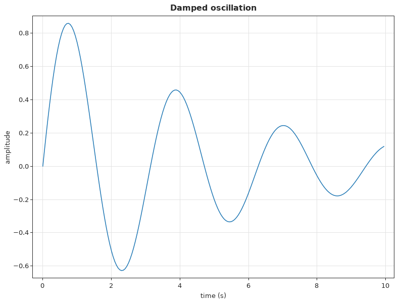
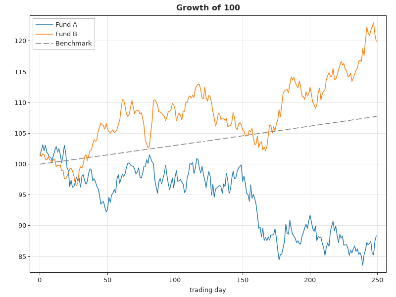
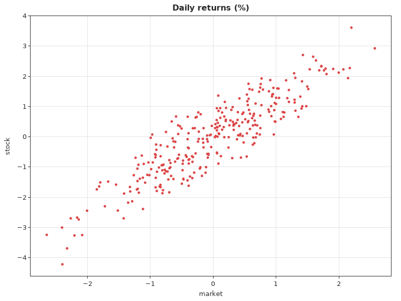
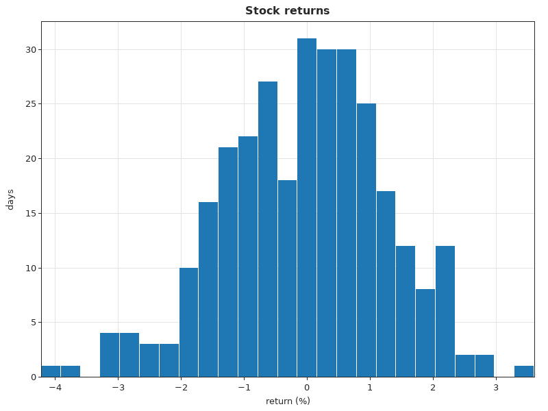
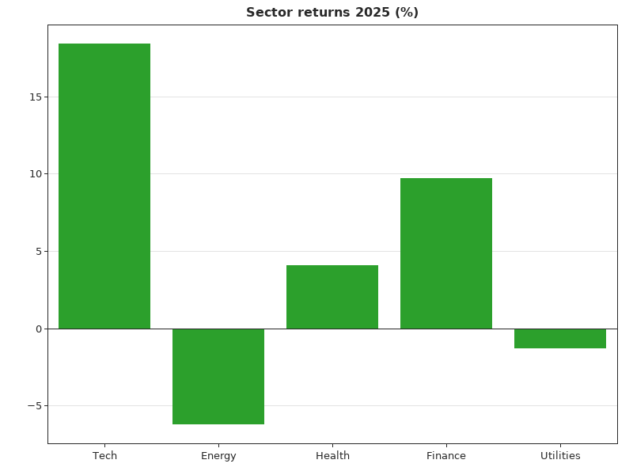
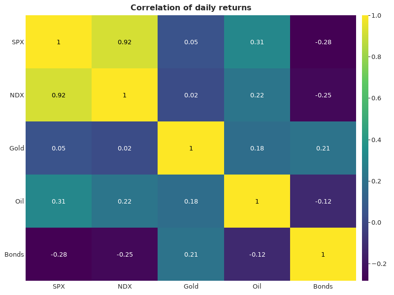
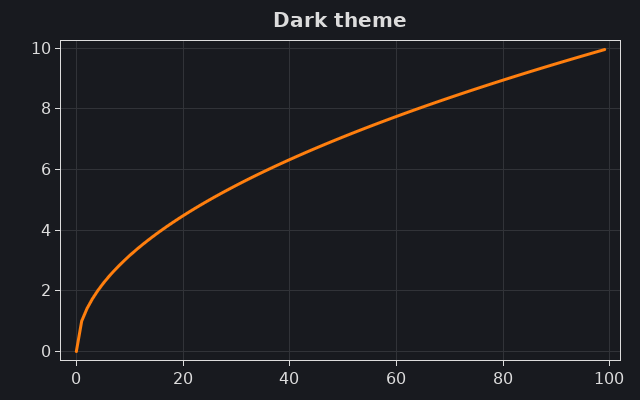
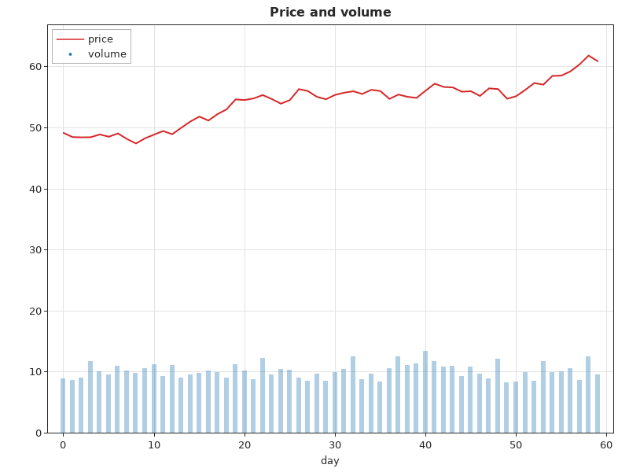

# The `plot` package: a user guide

`wotan/plot` draws charts and writes them as PNG files. It needs no external libraries: the rasteriser, the font and the PNG encoder are written in Odin. It provides:
- line charts with one or several series, scatter plots, histograms, bar charts and heatmaps, each written by one procedure call;
- configurable sizes, colours, fonts, line styles, grids, titles and axis labels;
- axes with "nice" ticks, labels with consistent precision, and margins that grow to fit the labels;
- anti-aliased lines and markers, and text in DejaVu Sans;
- the building blocks behind the charts, for drawing your own;
- a PNG encoder with its own DEFLATE compressor.

Every example was compiled and run against the current code; the images are the files it wrote. The PNG encoder was checked against independent decoders. Pillow decodes its files to exactly the source pixels, every chunk CRC and the zlib checksum verify, and the compressed size is within 1 % of zlib at level 6 (smaller on repetitive images). The examples leave no live allocations under a tracking allocator.

## Contents

1. [Setup](#1-setup)
2. [Configuration](#2-configuration)
3. [Line charts](#3-line-charts)
4. [Several series](#4-several-series)
5. [Scatter plots and histograms](#5-scatter-plots-and-histograms)
6. [Bar charts](#6-bar-charts)
7. [Heatmaps](#7-heatmaps)
8. [Themes](#8-themes)
9. [Axes and ticks](#9-axes-and-ticks)
10. [Drawing your own charts](#10-drawing-your-own-charts)
11. [PNG output and memory](#11-png-output-and-memory)
12. [Quick reference](#12-quick-reference)

## 1. Setup

```odin
import w "wotan/core" // only for scatter plots and histograms of DataFrame columns
import plot "wotan/plot"
import "core:fmt"
```

Inside the Wotan repository the path is relative, for example `import plot "../wotan/plot"` from `tests/`. The examples write their files to `DIR :: "docs/images/"`.

The chart procedures:

| Procedure | Draws |
|---|---|
| `line_png(xs, ys, path, config, allocator)` | one line |
| `multi_line_png(lines, path, config, allocator)` | several lines with a legend |
| `scatter_png(&df, x_col, y_col, path, config, allocator)` | two `Float` columns of a DataFrame as points |
| `histogram_png(&df, col, path, bins = 20, config, allocator)` | a histogram of a `Float` column |
| `bar_png(labels, values, path, config, allocator)` | one bar per label |
| `heatmap_png(data, rows, cols, path, row_labels, col_labels, config, allocator)` | a matrix as coloured cells with a colour bar |

Each procedure returns `true` once the file is written. It returns `false` if the input cannot be drawn or the file cannot be written:
- `xs` and `ys` of different lengths, or empty;
- a non-`Float` column (a column name the DataFrame doesn't have panics, as `DataFrame.column` does);
- `bins <= 0`;
- `len(data) != rows · cols`.

## 2. Configuration

Every chart takes a `PlotConfig`. Start from `DEFAULT_PLOT_CONFIG` and change the fields you need:

| Field | Default | Meaning |
|---|---|---|
| `width`, `height` | 800, 600 | image size in pixels |
| `margin_left`, `margin_right`, `margin_top`, `margin_bottom` | 60, 20, 20, 40 | minimum margins. They grow to fit the tick labels, axis labels and title. |
| `title`, `x_label`, `y_label` | "" | text above the plot and along the axes. Heatmaps use only the title. |
| `point_color` | `RED` | the colour of scatter points and of the line in `line_png` |
| `bar_color` | `BLUE` | bars and histogram bars |
| `axis_color` | dark grey | frame, ticks and text |
| `bg_color` | `WHITE` | background |
| `show_grid`, `grid_color` | false, light grey | grid lines at the ticks. The default grid colour follows the theme: a light tint of the axis colour over the background. |
| `line_style` | `.Solid` | `.Solid`, `.Dashed` or `.Dotted`, for `line_png` |
| `line_width` | 1.5 | line width in pixels |
| `font_size` | 0 | body text size in pixels. 0 uses `font_scale` (1 to 5: 11, 13, 16, 20 or 24 px). Titles are 1.25 times larger and bold. |

The colour constants follow matplotlib's "tab10" palette:
- `BLUE`, `ORANGE`, `GREEN`, `RED`, `PURPLE`, `BROWN`, `PINK`, `GRAY`, `OLIVE` and `CYAN`, plus `WHITE` and `BLACK`;
- `PALETTE` holds the ten palette colours in that order;
- a `Color` is `{r, g, b, a}` with 8-bit channels.

The font is DejaVu Sans, embedded at 10, 11, 13, 16, 20 and 24 px (bold at 13 to 24 px); other sizes use the closest one. It covers ASCII and the extra characters `αβγδεθλμνπρστφωΓΔΣΦΩ²³°±×÷·−–—≈≠≤≥∞√∑€£…‰`. Other characters are drawn as `?`.

Don't build a `PlotConfig` from an empty literal such as `plot.PlotConfig{width = 400, height = 300}`. Every field you leave out is zero, so the background is transparent black, the text is black and the font scale is the smallest. Copy `DEFAULT_PLOT_CONFIG` and change it instead.

## 3. Line charts

```odin
xs := make([]f64, 200)
ys := make([]f64, 200)
defer {delete(xs); delete(ys)}
for i in 0 ..< 200 {
	xs[i] = f64(i) / 20
	ys[i] = math.exp(-0.2 * xs[i]) * math.sin(2 * xs[i])
}
cfg := plot.DEFAULT_PLOT_CONFIG
cfg.title = "Damped oscillation"
cfg.x_label = "time (s)"
cfg.y_label = "amplitude"
cfg.show_grid = true
cfg.point_color = plot.BLUE // the line colour
ok := plot.line_png(xs, ys, DIR + "plot_line.png", cfg)
```



The points are joined in the order given, so sort them by x for an ordinary chart. NaN or ±infinity in `xs` or `ys` breaks the line: the segments next to such a point are not drawn, and neither is a single point between two gaps. The axes cover the finite values, with 3 % padding on each side.

## 4. Several series

`multi_line_png` draws a list of `LineData` values, each with its own `xs`, `ys`, `color`, `style` and `label`:
- **Colours.** A zero `color` takes the next colour of the palette.
- **Legend.** Lines with a label appear in a legend, placed in the corner of the plot that hides the fewest data points.
- **Invalid lines.** A line whose `xs` and `ys` differ in length is skipped and left out of the legend.

```odin
rand.reset(1)
n := 250
days := make([]f64, n)
a := make([]f64, n)
b := make([]f64, n)
c := make([]f64, n)
defer {delete(days); delete(a); delete(b); delete(c)}
pa, pb := 100.0, 100.0
for i in 0 ..< n {
	days[i] = f64(i)
	pa *= 1 + rand.float64_normal(0.0004, 0.012)
	pb *= 1 + rand.float64_normal(0.0002, 0.008)
	a[i], b[i] = pa, pb
	c[i] = 100 * math.pow(1.0003, f64(i))
}
c[120] = math.nan_f64() // a gap: NaN breaks the line
lines := []plot.LineData {
	{xs = days, ys = a, label = "Fund A"},
	{xs = days, ys = b, label = "Fund B"},
	{xs = days, ys = c, label = "Benchmark", color = plot.GRAY, style = .Dashed},
}
cfg := plot.DEFAULT_PLOT_CONFIG
cfg.title = "Growth of 100"
cfg.x_label = "trading day"
cfg.show_grid = true
ok := plot.multi_line_png(lines, DIR + "plot_multi.png", cfg)
```



The dash pattern runs continuously along each line instead of restarting at every point, so short segments still show dashes. Overlapping parts of the same line are not blended twice.

## 5. Scatter plots and histograms

Both take a DataFrame and column names (see the [core user guide](core_guide.md)). The columns must be of type `Float`; for other column types the procedures return `false`.

```odin
rand.reset(2)
df := w.dataframe_new()
defer w.destroy_dataframe(&df)
n := 300
x := w.column_new("market", .Float, n)
y := w.column_new("stock", .Float, n)
for _ in 0 ..< n {
	m := rand.float64_normal(0, 1)
	w.append_float(&x, m)
	w.append_float(&y, 1.2 * m + rand.float64_normal(0, 0.6))
}
w.add_column(&df, x)
w.add_column(&df, y)

cfg := plot.DEFAULT_PLOT_CONFIG
cfg.title = "Daily returns (%)"
cfg.x_label = "market"
cfg.y_label = "stock"
cfg.show_grid = true
ok1 := plot.scatter_png(&df, "market", "stock", DIR + "plot_scatter.png", cfg)

cfg.title = "Stock returns"
cfg.x_label = "return (%)"
cfg.y_label = "days"
ok2 := plot.histogram_png(&df, "stock", DIR + "plot_hist.png", bins = 25, config = cfg)
```





How the two charts treat the data:
- **Scatter.** Points with a NaN coordinate are skipped. The markers are slightly transparent, so dense regions look darker.
- **Histogram bins.** The bins split the range from the smallest to the largest finite value into `bins` equal parts; the last bin includes the maximum, as in NumPy. NaN and infinite values are not counted.
- **Histogram axes.** The x axis runs exactly over the bins, and the y axis starts at 0.

## 6. Bar charts

```odin
cfg := plot.DEFAULT_PLOT_CONFIG
cfg.title = "Sector returns 2025 (%)"
cfg.show_grid = true
cfg.bar_color = plot.GREEN
ok := plot.bar_png(
	{"Tech", "Energy", "Health", "Finance", "Utilities"},
	{18.4, -6.2, 4.1, 9.7, -1.3},
	DIR + "plot_bar.png",
	cfg,
)
```



How the bars are laid out:
- **Zero line.** The y axis always includes 0. With negative values, the bars hang down from a zero line.
- **Labels.** When the category labels are too wide for their slots, they are drawn vertically.
- **NaN.** A NaN value leaves its slot empty.

## 7. Heatmaps

`heatmap_png` draws a `rows × cols` matrix (row-major) as cells, coloured from dark blue to yellow on a viridis-like scale, with a colour bar on the right:
- **Labels.** `row_labels` and `col_labels` are optional (pass `nil`). Column labels are drawn vertically when they don't fit their cells.
- **Cell values.** Each cell shows its value when the cell is large enough, as an integer if it is one and otherwise with two decimals. The text is black or white depending on the cell's brightness.
- **Colour scale.** The scale runs from the smallest to the largest value. A constant matrix is drawn in one colour.

```odin
names := []string{"SPX", "NDX", "Gold", "Oil", "Bonds"}
corr := []f64 {
	1.00, 0.92, 0.05, 0.31, -0.28,
	0.92, 1.00, 0.02, 0.22, -0.25,
	0.05, 0.02, 1.00, 0.18, 0.21,
	0.31, 0.22, 0.18, 1.00, -0.12,
	-0.28, -0.25, 0.21, -0.12, 1.00,
}
cfg := plot.DEFAULT_PLOT_CONFIG
cfg.title = "Correlation of daily returns"
ok := plot.heatmap_png(corr, 5, 5, DIR + "plot_heatmap.png", names, names, cfg)
```



`get_heat_color(t)` returns the colour of a value `t` in [0, 1] on this scale, for your own charts.

## 8. Themes

All colours, the font size and the line width are configuration fields:

```odin
cfg := plot.DEFAULT_PLOT_CONFIG
cfg.bg_color = plot.Color{24, 26, 31, 255}
cfg.axis_color = plot.Color{220, 220, 220, 255}
cfg.point_color = plot.ORANGE
cfg.show_grid = true // the grid colour follows the theme
cfg.font_size = 16
cfg.line_width = 3
cfg.width, cfg.height = 640, 400
cfg.title = "Dark theme"
ok := plot.line_png(xs, ys, DIR + "plot_dark.png", cfg)
```



An opaque background gives an RGB PNG. A background with alpha below 255 gives an RGBA PNG with transparency, for example to place a chart on a web page.

## 9. Axes and ticks

The ticks are multiples of a "nice" step: 1, 2 or 5 times a power of ten, after Heckbert's "Nice numbers for graph labels". The number of ticks follows the plot size. On the x axis it is reduced until the labels fit side by side.

The labels of an axis share one precision, the fewest decimals that show every tick exactly. When the largest tick is at least 10⁶ or below 10⁻³, they switch to scientific notation. Negative numbers use the typographic minus sign. `nice_ticks` and `format_ticks` are public:

```odin
for r in ([][2]f64{{0, 1}, {0, 7.3}, {-2.5, 13}, {1e6, 5e6}, {0.0001, 0.0005}, {-1e-7, 3e-7}, {98.2, 103.9}}) {
	ticks, step := plot.nice_ticks(r[0], r[1], 6)
	labels := plot.format_ticks(ticks, step)
	fmt.printf("[%g, %g] step %g: %v\n", r[0], r[1], step, labels)
}
```
```
[0, 1] step 0.2: ["0.0", "0.2", "0.4", "0.6", "0.8", "1.0"]
[0, 7.3] step 1: ["0", "1", "2", "3", "4", "5", "6", "7"]
[-2.5, 13] step 5: ["0", "5", "10"]
[1e+06, 5e+06] step 1e+06: ["1e6", "2e6", "3e6", "4e6", "5e6"]
[0.0001, 0.0005] step 0.0001: ["1e−4", "2e−4", "3e−4", "4e−4", "5e−4"]
[-1e-07, 3e-07] step 1e-07: ["−1e−7", "0", "1e−7", "2e−7", "3e−7"]
[98.2, 103.9] step 1: ["99", "100", "101", "102", "103"]
```

The ticks lie inside the given range. The charts add padding to the data range first, 3 % by default, so their ticks usually reach the data's ends. A constant series gets a range of ±10 % around its value (±0.5 around 0).

### Fixed while writing this guide

These bugs were found while writing this guide and are now covered by `tests/plot_fixes_test.odin`:
- **`multi_line_png` crashed on a line whose `xs` and `ys` differ in length.** It skipped the line when drawing, but the legend placement still read the line's points. Such a line is now skipped everywhere, legend included.
- **Ticks with a step below 10⁻⁶ all got the same label.** On an axis from 1 to 1 + 2·10⁻¹², every label read "1". The labels now have enough decimals.
- **Scientific labels took a wrong exponent at some powers of ten.** The exponent came from log10, which falls just short of 300 for 10³⁰⁰, so ±10³⁰⁰ was labelled "10e299". It is now "1.0e300".

## 10. Drawing your own charts

The chart procedures are built from apublic pieces that you can combine:

| Piece | Procedures |
|---|---|
| Image | `image_new(w, h, allocator)`, `imge_clear`, `image_free`, `Image.pixels` (RGBA, row-major) |
| Primitives | `draw_pixel`, `blend_pixel`, `draw_line` (1 px, Bresenham), `draw_line_segment` (anti-aliased, styled), `draw_rect`, `draw_text`, `draw_string` (aligned), `draw_string_vertical` |
| Fonts | `font_get(size_px, bold)`, `font_size_for_scale`, `text_width`, `line_height` |
| Axes | `axes_setup(&img, cfg, xmin, xmax, ymin, ymax, opts)`, `axes_px`, `axes_py`, `axes_draw_grid`, `axes_draw_frame`, `axes_draw_legend`, `data_range` |
| Shapes | `coverage_new`, `cov_polyline`, `cov_segment`, `cov_disc`, `cov_flush`, `coverage_free`, `fill_rect_clipped` |
| Colours | `get_heat_color`, `grid_color_of` |
| Output | `image_save_png`, `image_encode_png` |

The usual steps:
1. **Set up the axes.** `axes_setup` lays out the plot box. It pads the data range and computes the ticks, labels and margins. `Axes_Options` adjusts it:
   - `pad_frac` (default 0.03);
   - `y_from_zero` (include 0, no padding on that side);
   - `x_exact` (no x padding);
   - `x_categories` (a categorical x axis at 0 … n − 1).
2. **Draw the background.** `axes_draw_grid` draws the grid.
3. **Draw the data.** `axes_px` and `axes_py` map data to pixels. Lines and markers are drawn into a *coverage buffer* and composited in one colour with `cov_flush`. Do one buffer pass per colour, so joints are clean and overlapping parts are not blended twice. `fill_rect_clipped` fills bars clipped to the plot box.
4. **Draw the frame and legend.** `axes_draw_frame` draws the frame, ticks, labels and title. `axes_draw_legend` adds the legend.

This chart combines volume bars and a price line:

```odin
rand.reset(3)
n := 60
price := make([]f64, n)
volume := make([]f64, n)
xs := make([]f64, n)
defer {delete(price); delete(volume); delete(xs)}
p := 50.0
for i in 0 ..< n {
	xs[i] = f64(i)
	p += rand.float64_normal(0.05, 0.8)
	price[i] = p
	volume[i] = 40 + 10 * abs(rand.float64_normal(0, 1))
}
cfg := plot.DEFAULT_PLOT_CONFIG
cfg.title = "Price and volume"
cfg.x_label = "day"
cfg.show_grid = true

img := plot.image_new(cfg.width, cfg.height)
defer plot.image_free(&img)
plot.image_clear(&img, 255, 255, 255, 255)
lo, hi := plot.data_range(price)
ax := plot.axes_setup(&img, cfg, 0, f64(n - 1), 0, hi * 1.05, {y_from_zero = true})
plot.axes_draw_grid(&ax)

// volume bars, scaled to the lower fifth of the price axis
bar := plot.Color{31, 119, 180, 90}
for v, i in volume {
	x := plot.axes_px(&ax, f64(i))
	plot.fill_rect_clipped(&ax, x - 3, plot.axes_py(&ax, v / 60 * 0.2 * hi), x + 3, plot.axes_py(&ax, 0), bar)
}
// the price line, anti-aliased through a coverage buffer
cv := plot.coverage_new(&ax, context.allocator)
defer plot.coverage_free(&cv, context.allocator)
px := make([]f64, n)
py := make([]f64, n)
defer {delete(px); delete(py)}
for i in 0 ..< n {px[i], py[i] = plot.axes_px(&ax, xs[i]), plot.axes_py(&ax, price[i])}
plot.cov_polyline(&cv, px, py, 1.0, .Solid) // half-width 1 px: a 2 px line
plot.cov_flush(&img, &cv, plot.RED)

plot.axes_draw_frame(&ax)
entries := []plot.Legend_Entry{{"price", plot.RED, .Solid, false}, {"volume", plot.BLUE, .Solid, true}}
plot.axes_draw_legend(&ax, entries, {xs}, {price}, context.allocator)
ok := plot.image_save_png(&img, DIR + "plot_custom.png")

png := plot.image_encode_png(&img) // the same file as bytes, e.g. for an HTTP response
defer delete(png)
fmt.println("PNG bytes:", len(png), png[1:4])
```
```
PNG bytes: 19001 [80, 78, 71]
```



A legend entry with `marker = true` shows a dot instead of a line sample. `axes_draw_legend` takes the data points of every series, `{xs}` and `{price}` here, to choose the emptiest corner.

## 11. PNG output and memory

**The encoder.** `image_encode_png(&img, allocator)` returns the PNG file as bytes, and `image_save_png(&img, path)` writes it:
- **Colour type.** The file is 8-bit RGB when every pixel is opaque, and RGBA otherwise.
- **Filters.** Each row is filtered with the PNG filter (none, sub, up, average or Paeth) that suits it best.
- **Compression.** The rows are compressed by the package's own DEFLATE implementation: LZ77 with hash chains and lazy matching, and dynamic Huffman codes. Odin's `core:compress` can only decompress.
- **Checks.** Pillow decodes the files to exactly the source pixels, for opaque and transparent images from 1 × 1 to 1000 × 700, and Python's `zlib` inflates the image data and verifies its checksum. The compressed size is within 1 % of zlib at level 6 on noise, and 5 % smaller on a repetitive image. `crc32_checksum` and `zlib_compress` are public as well.

**Memory.** The chart procedures allocate the image buffer and their scratch space with the `allocator` argument, which defaults to `context.allocator`, and free it all before returning. Two kinds of short-lived data come from `context.temp_allocator` instead:
- the tick values and labels;
- the PNG bytes in `image_save_png`.

A program that writes many charts should call `free_all(context.temp_allocator)` from time to time, as `main.odin` does after each test. `nice_ticks` and `format_ticks` also default to the temporary allocator. Images you create yourself are freed with `image_free`, coverage buffers with `coverage_free`, and the result of `image_encode_png` with `delete`.

The fonts are embedded in the binary with `#load` and decoded once, on first use, without allocating.

## 12. Quick reference

| Area | Procedures and types |
|---|---|
| Charts | `line_png`, `multi_line_png`, `scatter_png`, `histogram_png`, `bar_png`, `heatmap_png` |
| Configuration | `PlotConfig`, `DEFAULT_PLOT_CONFIG`, `LineData`, `LineStyle`, `Color`, `PALETTE`, `WHITE`, `BLACK`, `RED`, `BLUE`, `GREEN`, `ORANGE`, `PURPLE`, `BROWN`, `PINK`, `GRAY`, `OLIVE`, `CYAN` |
| Images | `Image`, `image_new`, `image_clear`, `image_free`, `image_save_png`, `image_encode_png` |
| Drawing | `draw_pixel`, `blend_pixel`, `draw_line`, `draw_line_segment`, `draw_rect`, `draw_char`, `draw_number`, `draw_text`, `draw_string`, `draw_string_vertical`, `H_Align`, `V_Align` |
| Fonts | `Font`, `font_get`, `font_glyph`, `font_size_for_scale`, `text_width`, `line_height` |
| Axes | `Axes`, `Axes_Options`, `axes_setup`, `axes_px`, `axes_py`, `axes_draw_grid`, `axes_draw_frame`, `axes_draw_legend`, `Legend_Entry`, `data_range`, `nice_ticks`, `format_ticks`, `grid_color_of`, `line_width_of` |
| Shapes | `Coverage`, `coverage_new`, `coverage_free`, `cov_segment`, `cov_disc`, `cov_polyline`, `cov_flush`, `fill_rect_clipped` |
| Colours | `get_heat_color` |
| Encoding | `zlib_compress`, `png_filter_rows`, `crc32_checksum`, `crc32_update` |
